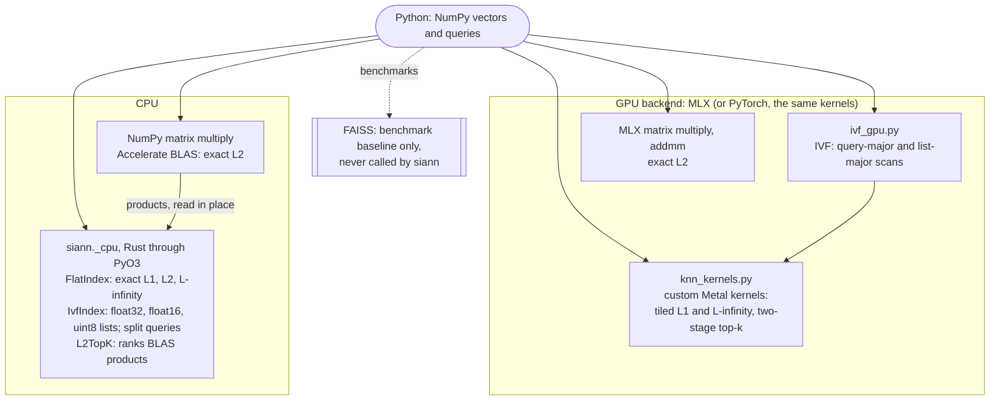
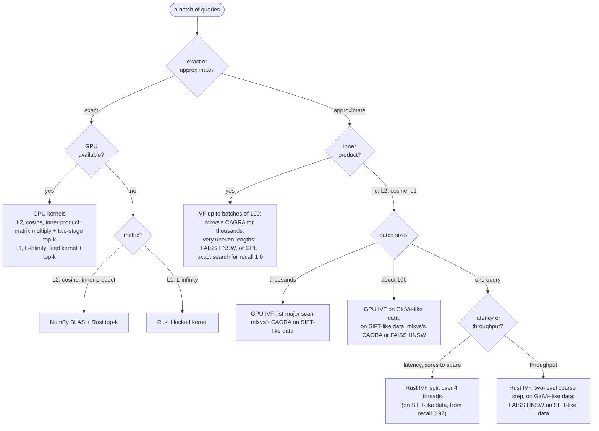
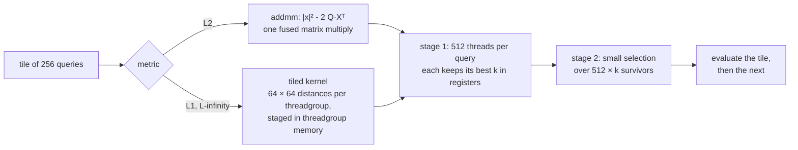
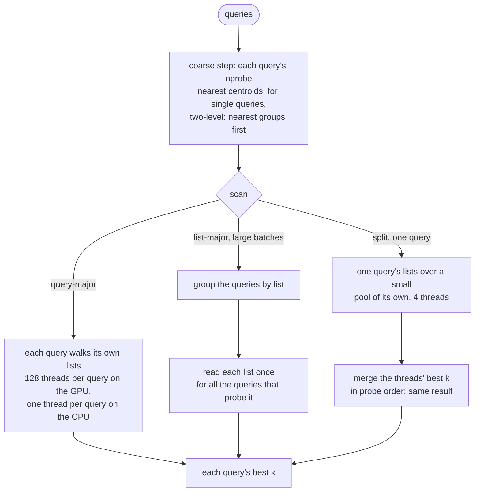

# Architecture

*Part of the [siann documentation](README.md#documentation).*

siann is fast similarity search on Apple silicon, and it is often several times faster than FAISS on
the same Mac with the same results. The speed does not come from a cleverer approximation: exact search
returns exactly FAISS's neighbors, and the IVF indexes use the same lists as FAISS's. It comes from
where the work runs and how it is laid out in memory. This page describes how the pieces fit together,
which path a search takes, why each path is faster than FAISS's, where FAISS stays ahead, and the rules
that keep the code fast. [ALGORITHMS](ALGORITHMS.md) describes each method in detail, and
[BENCHMARKS](BENCHMARKS.md) has the measurements and the scripts behind them.

## How the pieces fit together

siann has three backends: the CPU, and two GPU backends that run the same kernels, MLX and PyTorch. On
the GPU it runs custom Metal kernels (Metal is Apple's GPU language) through a GPU backend: MLX, Apple's
array framework, which compiles kernels written as source strings (`mx.fast.metal_kernel`), and is the
faster of the two on Apple silicon, or PyTorch's MPS backend (`torch.mps.compile_shader`). On the CPU it runs a small Rust extension, exposed to Python through PyO3
(the bridge that lets Python call Rust) and built with maturin (the tool that packages it as a Python
module), plus NumPy's matrix multiply, which on a Mac is Apple's Accelerate BLAS (the tuned
linear-algebra library). There is no Rust core between Python and the GPU: a GPU backend goes from
Python to Metal directly, and the kernels run at the same speed on both (see [BACKENDS](BACKENDS.md)).
FAISS appears only in the benchmarks: siann does not wrap it.

## Which path a search takes

The recommendation in [BENCHMARKS](BENCHMARKS.md#which-to-use), as a decision:

## Why siann is faster than FAISS

Each speed-up below comes from one choice, measured against the alternative or against FAISS
directly.

### On the GPU: custom kernels, not built-in operations

FAISS on a Mac runs on the CPU (its Metal GPU path crashes the machine, so it is not used). The GPU
alone is not enough: with only MLX's, PyTorch's or JAX's built-in operations, every GPU backend is
slower than FAISS on the CPU (0.25-0.65 times its speed). Four choices make the difference.

- **A dedicated top-k kernel,** the largest single gain: 4.1 ms per tile of 256 queries against a
  million vectors, where the frameworks' selection takes 146-152 ms, eight times the distances.
- **L1 and L-infinity laid out like a matrix multiply,** so that each base vector is read from memory
  once per 64 queries; a kernel that reads the base once per query runs at a third of the speed.
- **L2 as one fused multiply** (`addmm`): 6.9 against 17.7 ms per tile written as separate steps.
- **Each tile evaluated before the next,** so that MLX's lazy evaluation holds one tile's distances,
  not all of them: 0.9 s instead of 196 s for 10,000 queries.

The result for exact search with 1,000 queries: L2 8.2-8.7 times FAISS on SIFT1M and GloVe-100, L1
18.5-25 times, and L-infinity 47-49 times on random vectors, where FAISS's L-infinity takes three times
its own L1 time and siann's kernel takes the same time for both.

### On the CPU: memory layout, cache-sized tiles, and BLAS where it fits

- **L1 and L-infinity: a blocked layout.** FAISS's flat L1 runs at about 70 G absolute differences per
  second, well below what the cores can do. siann's Rust kernel stores the base in blocks of 8 vectors,
  dimension by dimension, so that 32 independent running distances let the compiler use NEON (Apple's
  vector instructions) without reordering floating-point additions, and scans the base in cache-sized
  tiles: about 270 G per second, 3.8-4.3 times FAISS for L1 and 7.3 times for L-infinity, in safe Rust.
- **L2: the same BLAS as FAISS, with cache-sized tiles.** FAISS's exact L2 is a BLAS multiply (Apple's
  Accelerate) followed by a top-k. siann does the same without FAISS: NumPy's `@` calls the same
  Accelerate, and a Rust top-k reads the products in place (through rust-numpy, without copying). With
  products of about 4 million values (16 MB), which stay in cache, siann is 1.7-1.9 times FAISS on 1,000
  queries and 3.0-3.6 times on 100. FAISS's own blocks (4,096 queries by 1,024 vectors) fall in the
  same window, so the difference is not simply its block size.

### Approximate search: read each list once per batch

An IVF index clusters the base vectors and scans only the lists (clusters) nearest each query. siann
and FAISS build the same lists from the same centroids, so they reach the same recall at each
setting; the difference is how they scan.

- **List-major scans.** FAISS's IVF scans each query's lists separately, so in a batch a popular list
  is read from memory once per query that probes it. siann's list-major scan reads each list once for
  all the queries that probe it (about 160 per list in a batch of 10,000 at nprobe 64): on the CPU,
  2.2-4.0 times FAISS's IVF with the same float32 lists; on the GPU, 5.0 times compressed HNSW on
  GloVe-100 and 1.2-1.3 times on SIFT1M.
- **Small batches on the GPU: cheap probe selection, merged in the kernel.** Choosing each query's
  nprobe lists in order costs as much as the scan, since at nprobe 64 each thread's running top-64 does
  not fit in registers; the scans need the lists in no order, so MLX's `argpartition` chooses them, at a
  third of the cost. Each query's 128 threads merge their candidates in threadgroup memory and write
  only k results. This puts the GPU IVF level with compressed HNSW on SIFT at recall 0.99 in batches of
  100, and ahead above it.
- **Split single queries.** A single query on one thread is not limited by memory traffic, so siann
  spreads one query's coarse step and lists over a pool of 4 threads of its own and merges their
  results in probe order, giving exactly the one-thread result, 1.3-2.0 times sooner. A shared pool
  costs about 100 microseconds per query to wake its threads; FAISS's own split (`parallel_mode = 1`)
  pays that cost.
- **A two-level coarse step for single queries.** Comparing a query with all 4,000 centroids is half of
  a single query's work. Comparing it first with 64 groups of centroids, then with the centroids of its
  16 nearest groups, makes single queries 1.1-2.1 times faster on one thread, with at most 0.011 less
  recall.
- **Smaller lists.** In batches, the query-major scan is limited by memory traffic, so lists stored in
  float16 (half the bytes) or, for byte data like SIFT's, uint8 (a quarter) make it 1.3-3.0 times as
  fast in batches of 100, with recall unchanged.
- **Integer arithmetic for byte lists.** A query whose coordinates are all integers from 0 to 255 is
  compared with byte lists in exact integer arithmetic, over a row-major copy of the lists: 1.8 times
  the float path on one thread, level with FAISS's IVF. Other queries take the float path, so nothing
  is rounded.

## Where FAISS is faster, and why

The baseline is always FAISS's strongest option, its compressed indexes included, and this is where it
wins:

- **HNSW for small batches on SIFT-like data.** HNSW (a graph index) touches 7-9 times fewer vectors
  per query than an IVF on SIFT (4-5 times on GloVe, where its scattered reads cost it the difference),
  and compressing its vectors speeds it up 1.6-2.3 times, as much as it speeds up the IVF. Compressed
  HNSW leads in batches of about 100 on SIFT below recall 0.99 (1.2-1.5 times) and on single queries on
  one thread (1.3-1.45 times); with 4 threads per query siann leads from recall 0.97.
- **HNSW on vectors of very uneven length.** On raw GloVe (lengths 0.04 to 18.7) no IVF reaches high
  recall, and FAISS's HNSW with inner product is the approximate method; siann's exact search on the
  GPU, 4-18 times FAISS's exact search, is the choice where recall must be 1.0. On Music-100, the
  standard inner-product benchmark, siann's IVF (its lists assigned by L2) is level with HNSW up to
  batches of 100 and 2.1-2.3 times HNSW in batches of 10,000.
- **FAISS's byte lists round the query.** For uint8 lists, FAISS rounds the query to integers and
  computes in integer arithmetic: exact for integer queries such as SIFT's, approximate for others.
  siann's integer path is level with it on one thread and applies to integer queries only, so it is
  always exact.

GloVe-like data favors siann at every batch size, because HNSW must walk much further through its graph
there for the same recall, while an IVF's dense scans do not care.

## Where mlxvs is faster, and why

mlxvs runs NVIDIA cuVS's methods on MLX, among them CAGRA, a graph index built for the GPU. siann's
exact search is 2.6-5.7 times mlxvs's and its IVF 1.2-4.2 times mlxvs's IVF-Flat, but a graph touches
far fewer vectors per query than an IVF, as HNSW does on the CPU, so CAGRA is faster where graphs are:
on SIFT-like data, 1.2-1.5 times siann's GPU IVF in batches of 100 and 2.1-2.6 times in batches of
10,000, and on inner product (Music-100) 1.45-1.5 times in batches of 10,000. On GloVe-like data the two
are level, and CAGRA reaches recall 0.882 at most in the settings measured. mlxvs has no L1 or
L-infinity, and on single queries siann's CPU path is 2.7-5.2 times faster than mlxvs's GPU. On
1,536-dimensional text embeddings (measured on 100,000 vectors) the matrix multiply, the same in both,
dominates exact search, so siann's lead there shrinks to 1.1-1.2 times, and CAGRA is 1.9-2.8 times
siann's GPU IVF.

## Code layout

| File | What it holds |
| --- | --- |
| `python/siann/knn_kernels.py` | The MLX Metal kernels: the two-stage top-k, the tiled L1 and L-infinity kernel, fused L2 |
| `python/siann/exact.py` | Exact search on the GPU, a tile of queries at a time |
| `python/siann/ivf_gpu.py` | The GPU IVF: k-means build, query-major and list-major scans, float16 and uint8 lists |
| `python/siann/blas_l2.py` | Exact L2 and inner product on the CPU through NumPy's BLAS and `L2TopK`, with the default tile sizes |
| `python/siann/torch_kernels.py`, `ivf_torch.py` | The same kernels on PyTorch MPS |
| `crates/siann-py/src/lib.rs` | The Rust extension, `siann._cpu`: `FlatIndex`, `IvfIndex` (storages, split queries), `L2TopK` |
| `benchmarks/check_kernels.py` | Every kernel and index against NumPy's exact search |
| `benchmarks/` | The benchmarks against FAISS (`backends.py`, `ivf_cpu.py`, `fp16_lists.py`, `single_query.py` and others), their raw output in `results/` |

The Python package lives in `python/siann/`, and maturin (the tool that builds Rust extensions for
Python) compiles the Rust crate into it as `siann._cpu`; `pyproject.toml` at the top of the repository
ties the two together.

## Rules for changing the code

- **Exact search is the oracle.** Every kernel and index is checked against NumPy's exact search
  (`check_kernels.py`), and changes that should not move results are checked bit for bit against
  outputs saved before the change.
- **Every number from a committed script,** with its raw output in `benchmarks/results/` and its place in
  [BENCHMARKS](BENCHMARKS.md), including the approaches that do not pay
  ([ALGORITHMS](ALGORITHMS.md#what-does-not-pay)).
- **A new default must be no slower than the old one on any measured case,** single queries, batches
  of 100 and batches of 10,000 alike.
- **Pass sizes such as the batch size at run time, not as compile-time constants,** in GPU kernels, or
  every new batch size recompiles them.
- **Safe Rust.** No `unsafe` in siann's code; every case has a safe alternative (NumPy for BLAS
  calls, a compare-and-select for the maximum, a buffer for float16, plain loops over contiguous bytes
  for the integer path). The compiler turns plain loops into NEON instructions, and five rules keep
  them fast:
  1. **Check the assembly, not just the timing.** The compiler's choice of which loop to vectorize
     decides the speed, and it is easy to see in the emitted instructions (`fabd.4s`, `udot`) and easy
     to miss in a timing alone.
  2. **Write a floating-point maximum as a comparison and select.** `f32::max` (and an integer maximum
     on the float bits) is a reduction the compiler may reorder, so it vectorizes across dimensions and
     L-infinity takes twice L1's time; the select keeps one running maximum per lane (1.4 times L1's
     time).
  3. **Choose the layout for the arithmetic.** Floating-point sums may not be reordered, so the blocked
     layout (8 vectors per block, dimension by dimension) gets one running distance per lane. Integer
     sums may be reordered, so for byte lists the integer path reads each vector's bytes contiguously,
     where a plain loop compiles to 16-byte absolute differences (`uabd`) and the dot-product
     instruction (`udot`); in the blocked layout the same arithmetic is no faster than float.
  4. **Loop over flat slices.** Widening float16 over nested `[u16; 8]` blocks makes the compiler load
     each value separately; over flat slices it is one 16-byte load per 8 values.
  5. **Give one query's parallel work a thread pool of its own** (rayon's `ThreadPoolBuilder`, made once
     per size): waking rayon's global pool costs about 100 microseconds per query, more than a split
     saves at low nprobe.
- **Why not call Accelerate from Rust?** Every call into a C library is `unsafe` in Rust. NumPy makes
  the call safely, and Rust only ranks the products, reading NumPy's arrays in place through rust-numpy
  (the PyO3 project's NumPy bindings), whose safe API keeps the `unsafe` inside the crate; copying the
  products instead would cost about as much as FAISS's whole search.
