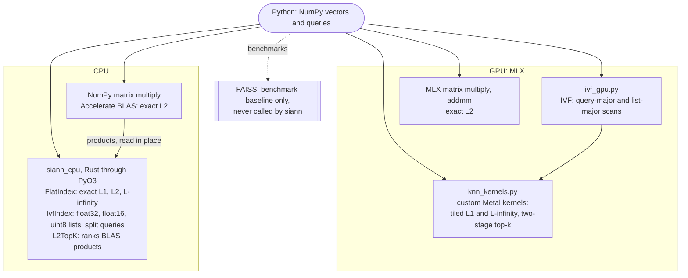
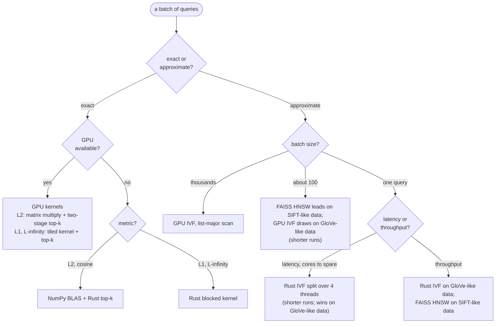
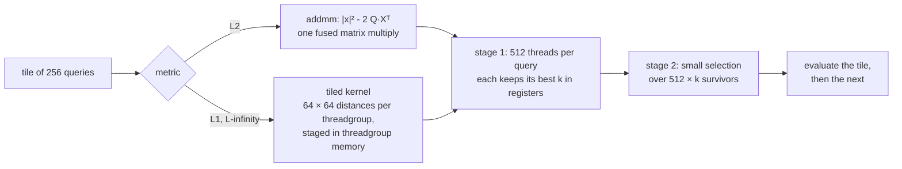
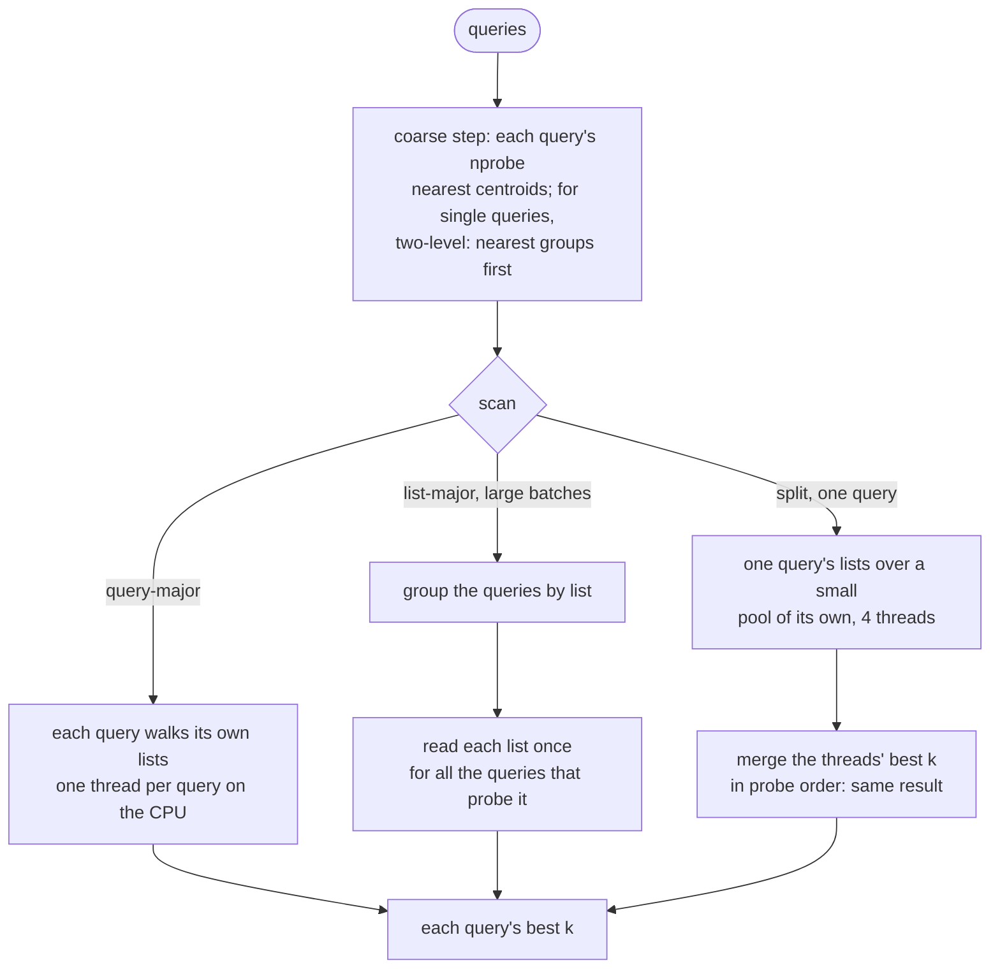

# Architecture

*Part of the siann documentation: [README](README.md), [ALGORITHMS](ALGORITHMS.md),
[ARCHITECTURE](ARCHITECTURE.md), [BACKENDS](BACKENDS.md), [DATASETS](DATASETS.md),
[BENCHMARKS](BENCHMARKS.md); measurements in [RESULTS](RESULTS.md).*

siann is fast similarity search on Apple silicon, and it is often several times faster than FAISS on
the same Mac with the same results. People reasonably ask how. The answer is not a cleverer
approximation: exact search returns exactly FAISS's neighbors, and the IVF indexes use the same lists
as FAISS's. The speed comes from where the work runs and how it is laid out in memory. This page
describes those choices, how the pieces fit together, and where FAISS stays ahead and why.

The code described here is in [proto/](proto/). Every number below is from an
Apple M3 Max against FAISS 1.16 on the CPU, from a script named in
[RESULTS](RESULTS.md).

## How the pieces fit together

siann has two homes for its work. On the GPU it runs custom Metal kernels (Metal is Apple's GPU
language) through MLX, Apple's array framework, which compiles kernels written as source strings
(`mx.fast.metal_kernel`). On the CPU it runs a small Rust extension, exposed to Python through PyO3
(the bridge that lets Python call Rust) and built with maturin (the tool that packages it as a Python
module), plus NumPy's matrix multiply, which on a Mac is Apple's Accelerate BLAS (the tuned
linear-algebra library). There is no Rust core between Python and the GPU: MLX goes from Python to
Metal directly. FAISS appears only in the benchmarks: siann does not wrap it, and
the GPU path is MLX alone (PyTorch's MPS backend runs siann's custom kernels at the same speed, but its matrix multiply is
slower, and it appears in the benchmark only).

## Which path a search takes

The measured recommendation from [BENCHMARKS](BENCHMARKS.md), as a decision. Nodes marked
*shorter runs* come from fewer settings than the rest.

## Why siann is faster than FAISS

Each speed-up below comes from one choice, measured against the alternative or against FAISS
directly.

### On the GPU: custom kernels, not built-in operations

FAISS on a Mac runs on the CPU (its Metal GPU path crashed the machine twice, so it is not used).
siann runs on the GPU, but the GPU alone is not enough: with only MLX's, PyTorch's or JAX's built-in
operations, every GPU backend is slower than FAISS on the CPU (0.25-0.65 times its speed). Four
choices make the difference.

- **A dedicated top-k kernel.** With the distances computed, the frameworks' own selection
  (`argpartition`, `topk`) takes 146-152 ms for 256 queries against a million vectors, eight times the
  distance computation. siann's two-stage selection (each of 512 threads per query keeps its best k
  in registers, then a small selection over the survivors) takes 4.1 ms: the largest single gain.
- **L1 and L-infinity laid out like a matrix multiply.** These metrics have no matrix-multiply form,
  so siann's kernel computes 64 × 64 blocks of distances per group of threads, staging queries and base
  vectors in threadgroup memory (a small, fast memory shared by a group of threads), so that each base
  vector is read from main memory once per 64 queries. A kernel that reads the base once per query is
  limited by memory speed, at a third of the speed.
- **L2 as one fused multiply.** `|q - x|² = |q|² - 2 q·x + |x|²`, and the first term does not change
  a query's ranking, so L2 is a matrix multiply plus precomputed norms, fused into one call
  (`addmm`): 6.9 against 17.7 ms per tile written as separate steps.
- **Evaluate each tile before the next.** MLX evaluates lazily (it builds a graph and runs it when a
  result is needed); left to the end, it kept every tile's distance matrix alive: 196 s instead of
  0.9 s for 10,000 queries.

The result for exact search with 1,000 queries: L2 8.2-8.7 times FAISS on SIFT1M and GloVe-100, L1
18.5-25 times, and L-infinity 47-49 times on random vectors, where FAISS's L-infinity takes three
times its own L1 time and siann's kernel takes the same time for both.

### On the CPU: memory layout, cache-sized tiles, and BLAS where it fits

**L1 and L-infinity: a blocked layout.** FAISS's flat L1 runs at about 70 G absolute differences per
second, well below what the cores can do. siann's Rust kernel stores the base vectors
once, at build time, in blocks of 8, dimension by dimension, and compares 4 queries with a block at a
time, keeping 32 independent running distances. Independent sums let the compiler use NEON (Apple's
vector instructions, 4 numbers at a time) without reordering floating-point additions, which it may
not do for a single sum. Each thread then scans the base in cache-sized tiles of 1,024 vectors for all
of its queries. The result is 3.8-4.3 times FAISS for L1 and 7.3 times for L-infinity, in safe Rust
(no `unsafe` code). Check the compiler's choices in the assembly: written with `f32::max`, L-infinity
vectorizes the wrong loop and takes twice L1's time; a comparison and select does not.

**L2: the same BLAS as FAISS, with cache-sized tiles.** FAISS's exact L2 is a BLAS multiply (Apple's
Accelerate, which runs matrix multiplies on the chip's matrix units) followed by a top-k. siann does
the same without FAISS: NumPy's `@` calls the same Accelerate, and a Rust top-k reads the products in
place (through rust-numpy, without copying) and keeps each query's best k across blocks of the base.
The tile size decides the speed: products of 4-8 million values (16-32 MB) per multiply are fast,
smaller ones pay per-call overhead, and larger ones drop out of cache and slow the multiply by about
half. With the default (up to 512 queries, about 4 million values per product), siann is 1.7-1.9
times FAISS on 1,000 queries and 3.0-3.6 times on 100. FAISS's own blocks (4,096 queries by 1,024
vectors) fall in the same window, so the difference is not simply its block size; FAISS itself has not
been profiled to find where its extra time goes.

**Why not call Accelerate from Rust?** Every call into a C library is `unsafe` in Rust, and siann
keeps the bar for `unsafe` high. NumPy makes the call safely, so Rust only ranks the products.

### Approximate search: read each list once per batch

An IVF index clusters the base vectors and scans only the lists (clusters) nearest each query. siann
and FAISS build the same lists from the same centroids, so they reach the same recall at each
setting; the difference is how they scan.

- **List-major scans.** FAISS's IVF scans each query's lists separately, so in a batch a popular list
  is read from memory once per query that probes it. siann's list-major scan groups the queries by
  list and reads each list once for all of them (about 160 queries per list in a batch of 10,000 at
  nprobe 64). On the CPU the Rust list-major scan is 2.2-4.0 times FAISS's IVF with the same float32
  lists.
- **The GPU for large batches.** In batches of 10,000, the GPU IVF is 5.3-6.4 times FAISS's HNSW on
  GloVe-100 (5.0 times against HNSW with compressed vectors) and 2.0-2.7 times on SIFT1M (1.2-1.3 times
  against compressed HNSW).
- **Small batches on the GPU: cheap probe selection, merged in the kernel.** In a query-major call,
  choosing each query's nprobe lists with siann's ordered selection costs as much as the scan, since at
  nprobe 64 each thread's running top-64 does not fit in registers; the scans need the lists in no
  order, so MLX's `argpartition` chooses them, at a third of the cost. Each query runs 128 threads,
  which merge their candidates in threadgroup memory and write only k results. Together these make
  batches of 100 1.7-2.4 times faster, and put the GPU IVF level with compressed HNSW on SIFT at recall
  0.99 and ahead above it.
- **Split single queries.** A single query on one thread is not limited by memory traffic (which is
  also why compressed lists do not help it there), so siann can spread one query's coarse step and lists over a few threads and merge their results in
  probe order, which gives exactly the one-thread result. The split runs on a pool of 4 threads of its
  own, which cuts single-query latency 1.3-2.0 times: on rayon's global pool (all 16 cores), waking the
  threads costs about 100 microseconds per query, more than the split saves. FAISS's own split
  (`parallel_mode = 1`) pays that wake-up cost.
- **A two-level coarse step for single queries.** Comparing a query with all 4,000 centroids is half
  of a single query's work. Clustering the centroids into 64 groups and comparing the query with the
  groups' centres first, then with the centroids of its 16 nearest groups, makes single queries
  1.1-2.1 times faster on one thread (most at low nprobe), with at most 0.011 less recall.
- **Smaller lists.** The query-major scan is limited by memory traffic in batches, so lists stored in
  float16 (half the bytes) or, for byte data like SIFT's, uint8 (a quarter) make it 1.3-3.0 times as
  fast in batches of 100, with recall unchanged. FAISS compresses too, though (next section).
- **Integer arithmetic for byte lists.** A query whose coordinates are all integers from 0 to 255 is
  compared with byte lists in exact integer arithmetic, over a row-major copy of the lists (each
  vector's bytes contiguous, so that 16 fill a register and L2's sum is one dot-product instruction per
  16 values): 1.8 times the float path on one thread, level with FAISS's IVF. Other queries take the
  float path, so nothing is rounded.

## Where FAISS is faster, and why

siann's claims are only as good as the comparisons behind them, so the strongest FAISS option is
always the baseline, including FAISS's compressed indexes, and this is where it wins:

- **HNSW for small batches on SIFT-like data.** HNSW (a graph index) touches 7-9 times fewer vectors
  per query than an IVF on SIFT (4-5 times on GloVe, where its scattered reads cost it the difference),
  and compressing its vectors speeds it up 1.6-2.3 times, as much as it speeds up the IVF. Compressed
  HNSW leads in batches of about 100 on SIFT below recall 0.99 (1.2-1.5 times) and on single queries on
  one thread (1.3-1.45 times, against siann's two-level coarse step and integer path); with 4 threads
  per query siann leads from recall 0.97.
- **FAISS's byte lists round the query.** For uint8 lists, FAISS rounds the query to integers and
  computes in integer arithmetic: exact for integer queries such as SIFT's, approximate for others.
  siann's integer path is level with it on one thread (147 against 136 microseconds at nprobe 64) and
  applies to integer queries only, so it is always exact.
- **GloVe-like data favors siann throughout,** because HNSW must walk much further through its graph
  there for the same recall, while an IVF's dense scans do not care.

## Code layout

| File | What it holds |
| --- | --- |
| `proto/knn_kernels.py` | The MLX Metal kernels: the two-stage top-k, the tiled L1 and L-infinity kernel, fused L2 |
| `proto/ivf_gpu.py` | The GPU IVF: k-means build, query-major and list-major scans, float16 and uint8 lists |
| `proto/rust_cpu/src/lib.rs` | The Rust extension: `FlatIndex`, `IvfIndex` (storages, split queries), `L2TopK` |
| `proto/blas_l2.py` | Exact L2 on the CPU through NumPy's BLAS and `L2TopK`, with the default tile sizes |
| `proto/torch_kernels.py`, `proto/ivf_torch.py` | The same kernels on PyTorch MPS (benchmark only) |
| `proto/check_kernels.py` | Every kernel and index against NumPy's exact search |
| `proto/backends.py`, `ivf_cpu.py`, `fp16_lists.py`, `single_query.py` | The benchmarks against FAISS |

## Conventions

- **Exact search is the oracle.** Every kernel and index is checked against NumPy's exact search
  (`check_kernels.py`), and changes that should not move results are checked bit for bit against
  outputs saved before the change.
- **Safe Rust.** No `unsafe` in siann's code; the bar for it is high, and every case has had a safe
  alternative (NumPy for BLAS calls, a compare-and-select for the maximum, a buffer for float16, plain
  loops over contiguous bytes for the integer path).
- **Every number from a committed script,** with its raw output in `proto/results/` and its finding in
  [RESULTS](RESULTS.md), including the approaches that do not pay.
