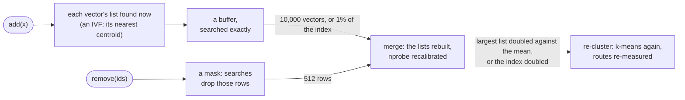
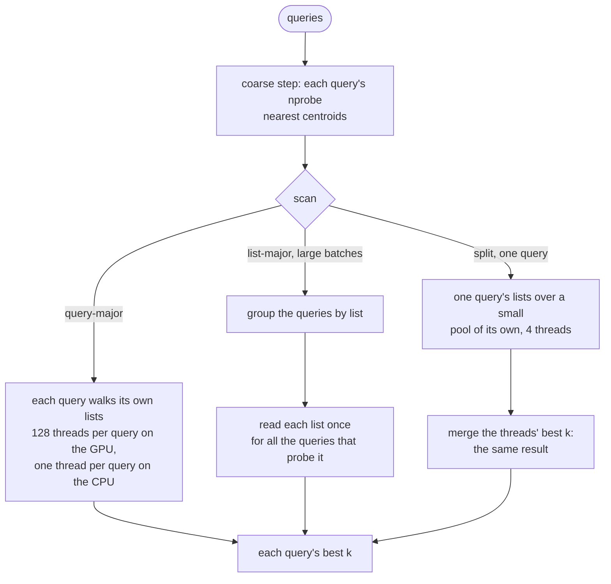
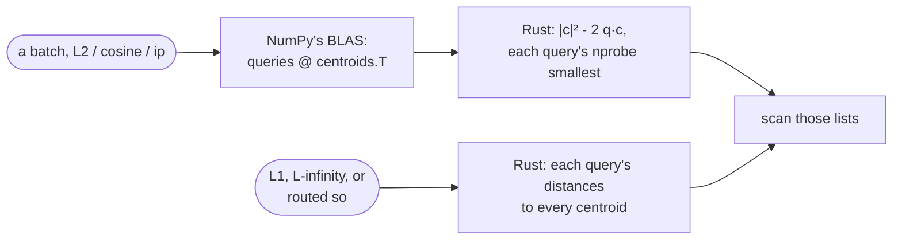
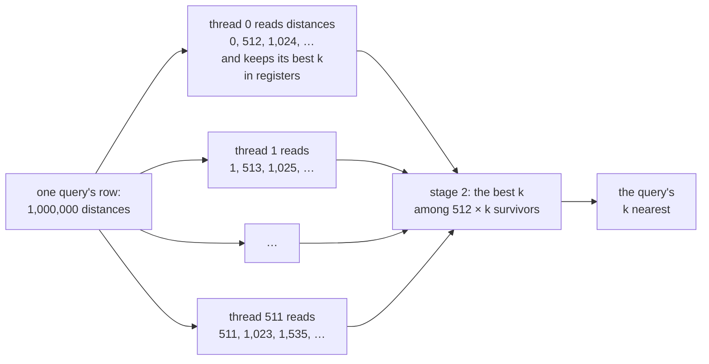

# Implementation

*Part of the [siann documentation](README.md#documentation).*

siann answers k-nearest-neighbor queries: given base vectors and a query, find the k base vectors
nearest the query, exactly or to a recall target. It is fast for two reasons. The main one is that it
**chooses**: given a recall target, it measures on your data and your machine which method, which settings
and which device meet the target fastest, for each batch size, and reports what it chose. The other is that
**each of the paths it chooses between is fast**, through custom GPU kernels and CPU code laid out for the
hardware. This page covers the choice first, then the methods, then the kernels in detail, where other
libraries are faster, what does not pay, and how the code is organized. [BENCHMARKS](BENCHMARKS.md) has
the measurements, on an Apple M3 Max, and the scripts behind them.

## Why siann is fast

### It chooses the fastest way to meet the target

How fast a search can be depends on the workload: the data, the metric, the machine, the batch size and
the recall wanted. siann takes the recall target, not the settings, and measures the rest:

| Choice | Made from | Gain, measured |
| --- | --- | --- |
| Exact search or an IVF | both timed on a sample of queries | the IVF 2-11 times faster than exact search on every dataset measured; exact search kept where an IVF needs most of its lists (inner product on vectors of very uneven length) |
| How many lists a query scans (nprobe) | the smallest that reaches the target on a sample of queries | on queries like the real ones: the target kept on SIFT1M (0.955, where its own vectors give 0.940), and Music-100's index 2.0-2.8 times faster than when calibrated on its own vectors |
| CPU or GPU, and which scan, by batch size | each scan timed on 1 to 4,096 queries when the index is built | 1.2-6.3 times fixed thresholds at 2-64 queries, 1.2-1.9 times at larger batches where they differ; one loss (0.77 times, Music-100 at 512 queries), timed on the index's own vectors rather than on queries |
| How the lists are stored | the data | bytes where lossless (a quarter of float32's memory traffic), float16 for GPU batches |
| CPU or GPU for exact search | a profile, measured by `siann.tune` | single L2 queries on the CPU (153 against 143 per second on SIFT1M, 177 against 140 on DBpedia); at 200,000 vectors the CPU is faster up to 16 queries |

The choices interact, which is why they are measured together rather than set from rules of thumb: where
the CPU and the GPU cross depends on how many lists a query scans, so on SIFT1M at nprobe 46 the CPU wins
up to 16 queries and the GPU's query-major scan up to 1,024, while on GloVe-100 at nprobe 370 the GPU wins
from 8 queries and its list-major scan at every size. `index.plan` reports every choice and its reason,
and each can be overridden ([below](#overrides)).

With a latency budget as well as a recall target, `siann.tune(xb, xq, recall=...)` prints the measured
queries per second of every path at each batch size, on your data, so you can see which batch sizes fit.

Other libraries leave these choices to you. FAISS and mlxvs offer a family of indexes and their
parameters, and you pick the index, its settings and, for FAISS, the device. FAISS's auto-tuning
(`ParameterSpace`) explores one index's parameters for the trade-off between recall and time, on one
device, against ground truth you compute; it does not choose between exact and approximate search, between
scans, or between the CPU and the GPU. mlxvs runs only on the GPU, so single queries and small batches,
where the CPU is several times faster, go to the GPU too.

### Each path is fast

The choice is worth making only if every option is fast. Written with a framework's built-in operations,
every GPU backend is slower than FAISS on the CPU (0.25-0.65 times its speed), so siann runs its own
kernels:

- **On the GPU,** custom Metal kernels (Metal is Apple's GPU language): a dedicated top-k selection, L1 and
  L-infinity laid out like a matrix multiply, L2 as one fused multiply, and IVF scans that read each list
  once per batch. Exact search on 1,000 queries runs at 8.2-8.7 times FAISS for L2 on SIFT1M and GloVe-100,
  18.5-25 times for L1 and 47-49 times for L-infinity.
- **On the CPU,** Rust kernels with a memory layout that lets the compiler use the vector instructions,
  scanned in cache-sized tiles, and BLAS (the tuned linear-algebra library) for L2: exact L1 at 3.8-4.3
  times FAISS, L-infinity at 7.3 times, L2 at 1.7-1.9 times on 1,000 queries; the IVF's list-major scan
  at 2.2-4.0 times FAISS's IVF with the same lists.

[The kernels](#the-kernels-in-detail) has the detail.

## How siann chooses

### Which path a search takes

### From a recall target to an index

`siann.Index(xb, metric, recall=0.95)` turns a recall target into an IVF and its settings, in about 5-9
seconds for a million vectors:

1. **The lists:** about 4 sqrt(n) of them (4,000 for a million vectors), from siann's k-means, stored as
   bytes where every coordinate is an integer from 0 to 255 (lossless), and otherwise as float16 on the GPU
   (recall moves by at most 0.001) and float32 on the CPU.
2. **Calibration:** a sample of 1,000 queries is searched exactly, then with the IVF at a doubling nprobe
   until it reaches the target recall@10, and a bisection narrows nprobe to the smallest that does. The
   sample is the index's own vectors (each one's own match left out) unless representative queries are
   given (`calibration_queries=`). Recall counts a neighbor as found when it is no farther than the true
   10th, so that ties broken differently are not misses.
3. **IVF or exact:** the IVF at the calibrated nprobe is timed against exact search on the same sample, and
   the index keeps whichever is faster.
4. **Routing:** the index times its CPU scans (one query split over 4 threads, one thread per query with
   its coarse step in Rust or through BLAS, and list-major) and its GPU scans (query-major and list-major) on 1 to 4,096 of the calibration queries,
   each path by itself, back to back, after a warm-up pass on the GPU (right after calls on the CPU, GPU
   calls run up to 40% slower, which would favor the CPU). A measured route replaces the default one
   (single queries on the CPU, the GPU's query-major scan below 1,000 queries, its list-major scan from
   1,000) only where it was at least 10% faster, about the timings' spread, and between the batch sizes
   measured the default holds. Single queries use the exact coarse step: the two-level one lowers recall
   by up to 0.011, below what calibration promised.

Exact search routes by a *profile*: for each metric, the batch size from which the GPU is faster. siann's
default profile was measured on an Apple M3 Max with about a million vectors; `siann.tune` measures one on
your data and machine ([TUNING](TUNING.md)).

### Overrides

Every choice can be overridden: `kind="exact"` or `"ivf"`, `nlist=`, `storage=`, `device="cpu"` or
`"gpu"` (for the index or for one search), `search(..., nprobe=)` for one search, and a profile with
thresholds of its own for both exact and approximate routing ([TUNING](TUNING.md)).

### Saving and loading

`index.save(path)` writes one NumPy `.npz` file, read back with pickling disabled: the base vectors (as
bytes where every coordinate is an integer from 0 to 255), the IVF's centroids and each vector's list,
the calibration sample, and a JSON header with the metric, the recall target, the calibrated nprobe, the
storage, the routes, the profile and the plan, with the machine the routes were measured on.
`siann.Index.load(path)` rebuilds each device's copy of the lists from them the first time a search needs
it, as when the index was built, so the file assumes no device. What the index decided from the data, its
lists and nprobe, and its choice between the IVF and exact search, are kept, so a loaded index returns the
same neighbors anywhere. What it decided from the machine, its routes and profile, is kept on the same
machine and re-measured on another (`remeasure=` forces either). A file of a later format is refused.

### Changing an index

`index.add(x, ids=)` adds vectors and `index.remove(ids)` removes them. Each vector has an id, which searches
return: its row number unless `ids=` names it. Rebuilding each device's copy of the index for every change
would cost about a second per million vectors, so changes are gathered first:

- **Added vectors join the lists of their nearest centroids,** which stay as they are. That keeps the IVF's
  recall: as a collection grows, even tenfold or into regions its centroids never saw, recall at the
  calibrated nprobe holds or rises. Until the buffer is merged, its vectors are searched exactly and the
  two sets of results merged by score.
- **nprobe is recalibrated at every merge,** on the calibration sample (a fresh sample of the index's own
  vectors, or the given queries), so that the target holds after changes: queries in new regions can fall
  below it otherwise.
- **The cost of inserting without re-clustering is speed, through unbalanced lists,** as new vectors crowd
  into the lists nearest them. So the IVF is re-clustered when its largest list against the mean has
  doubled since its last clustering, or the index has doubled in size (the number of lists grows with it).
  `index.recluster()` does it on request. Re-clustering runs in the `add()` that crosses the threshold.
- **Removed vectors are masked,** and each search fetches 8 more neighbors than asked and drops them; a
  query that lost more than 8 is searched again, fetching as many more as are masked, so results stay
  exact. The index is compacted, and nprobe recalibrated, once 512 are masked.
- `index.save()` merges and compacts first, and the file keeps the ids. `index.plan` says what changed,
  when the index last merged and re-clustered, and why.

The measurements behind these choices are in BENCHMARKS, [Changing an index](BENCHMARKS.md#changing-an-index).

## Distances

- **L2** (Euclidean): the square root of the sum of squared differences. Searches compare squared
  distances, which rank the same way and need no square root.
- **L1** (Manhattan): the sum of absolute differences. It is less sensitive to a few large
  differences than L2, and has no matrix-multiply form (see below), which makes it the harder case
  and the one where siann gains most.
- **L-infinity** (Chebyshev): the largest absolute difference in any one coordinate. It shares L1's
  kernels, with a running maximum where L1 keeps a running sum. A maximum involves no rounding, so
  its distances are exact.
- **Inner product:** q·x, largest first, for embedding models trained to be compared by it. siann
  ranks by -q·x, so that smaller is nearer, as for the distances. Exact search is a matrix multiply,
  like L2 without the norms.
- **Cosine:** the angle between vectors. Normalized to unit length, vectors rank by cosine exactly as
  they rank by L2, so cosine search is L2 search on normalized vectors (see [DATASETS](DATASETS.md)).

## The search methods

### Exact search

Exact search computes a distance for every pair of query and base vector, then keeps each query's k
smallest.

**L2 as a matrix multiply.** The squared distance expands to `|q - x|² = |q|² - 2 q·x + |x|²`. The term
`|q|²` is the same for every base vector of a query, so it does not change the ranking and is dropped.
What remains, for a tile of queries Q against all base vectors X, is `|x|² - 2 Q Xᵀ`: one matrix
multiply, which GPUs and the CPU's BLAS do at close to their peak speed, plus the base vectors' squared
norms, computed once. Inner product is the same multiply without the norms.

**L1 and L-infinity** have no such expansion, so every distance is computed coordinate by coordinate,
by kernels laid out like a matrix multiply so that each base vector is read from memory once for many
queries.

**Top-k selection.** With the distances computed, each query needs its k smallest of a million, which is
as costly as the distances unless it is done carefully (see the kernels below).

### IVF: approximate search

An IVF (inverted file) index clusters the base vectors and searches only the clusters nearest the
query. It trades a little recall (the share of the true k nearest neighbors found) for a large cut in
work.

**Building.** k-means (siann's own, on the GPU where there is one: 10 iterations of Lloyd's algorithm on a
sample of 100 vectors per cluster, from randomly chosen starting vectors) finds the cluster centers, the
centroids. Each base vector then goes to the list of its nearest centroid in the search metric, found by
exact search, except for inner product, whose lists are assigned by L2 (by inner product, centroids
pointing towards long vectors attract much of the data and the lists fall badly out of balance). k-means
itself runs in L2, even for an L1 index: the centroids only need to spread over the data. Queries always
probe by the search metric. Where the probed lists hold fewer than k vectors, the missing neighbors are
returned as -1. The GPU and CPU IVFs take their lists from the same build, so they hold the same lists.

**Searching.** A query's `nprobe` nearest centroids (the coarse step) give the lists to scan; the k
nearest vectors among those lists are the answer. Raising `nprobe` raises recall and cost: on SIFT1M
with L2, nprobe 16 finds 84% of the true neighbors, nprobe 64 97%, nprobe 128 99%.

**Query-major and list-major scans.** There are two ways to scan:

- **Query-major:** each query walks its own lists. Cheap for a single query, but in a batch every query
  reads its lists separately, so a popular list is read from memory many times. FAISS's IVF scans this
  way.
- **List-major:** queries are first grouped by the lists they probe, and each list is scanned once for
  all of them, then each query's results from its lists are merged. In a batch of 10,000 queries at
  nprobe 64, each list is probed by about 160 of them, and read once instead of 160 times.
- **Split single queries:** a single query's coarse step and lists divided among a few threads (a pool of
  their own, 4 by default), each keeping its own best k, merged into the one-thread result, ties included. This cuts a single query's latency, 1.3-2.0 times, at the cost of
  occupying the threads.

Which scan pays depends on the batch and on nprobe, which is why each index measures its routing. Every
scan returns the same neighbors: among vectors at exactly the same distance, the one with the smaller id
comes first, whatever order the lists were scanned in (ties are common on integer data such as SIFT's).

**The coarse step.** Finding the nearest nprobe centroids is itself a small exact search (4,000
centroids), and for a single query it is half the work at nprobe 16. A two-level coarse step cuts it:
the centroids are clustered into groups (64 for 4,000 lists), and a query is compared with the groups'
centres, then only with the centroids of its nearest groups (16 of 64): single queries 1.1-2.1 times
faster on one thread, with at most 0.011 less recall.

For a batch on the CPU, by L2, cosine or inner product, the coarse step can instead be one BLAS matrix
multiply of the queries against the centroids, whose products Rust ranks as it ranks its own distances,
finding the same lists. The list-major scan always does it this way (1.06-2.0 times faster from 10 queries). For the
query-major scan it depends on the machine: with 4 threads it pays from about 32 queries (up to 1.6 times
faster), with 16 it does not, as each query's own coarse step is already spread over 16 cores. So it is a
route each index measures (BENCHMARKS, [The coarse step](BENCHMARKS.md#the-coarse-step)).

**List storage.** The scan reads every vector of every probed list, so in a batch of queries scanned one
by one it is limited by memory traffic, not arithmetic. The lists can therefore be stored in a smaller
type, with distances still computed in float32 from the stored values:

- **float16** (half the bytes): each coordinate rounded to half precision. On SIFT, whose coordinates are
  small integers, this is exact; on GloVe it changes each coordinate by at most 2.4e-4, and recall by at
  most 0.001.
- **uint8** (a quarter): one byte per coordinate, for data whose coordinates are integers from 0 to 255,
  like SIFT's, so nothing is lost. Other data is refused: scaling it into bytes (int8 quantization) would
  lose precision and need re-ranking.

Smaller lists make the query-major scan 1.3-3.0 times as fast in batches of 100, with recall unchanged.
They cost where the scan is not memory-bound: a single query on one thread reads its lists below the
memory system's limit, so widening float16 is pure extra work, while the list-major scans already read
each list once for many queries.

## The kernels in detail

### On the GPU

siann's GPU kernels are Metal source, written once (`siann._metal`) and compiled by either GPU backend: MLX
(`mx.fast.metal_kernel`, the faster on Apple silicon) or PyTorch's MPS backend (`torch.mps.compile_shader`).

The two-stage top-k, for one query's row of distances to a million base vectors:

Every thread reads the row once, in a pattern where neighboring threads read neighboring memory, and keeps
only k values, so nothing but the survivors is written back; a full selection over the row would sort or
partition all of it.

- **A two-stage top-k, the largest single gain.** The frameworks' own selection (`argpartition`, `topk`)
  takes 146-152 ms per tile of 256 queries against a million vectors, eight times the distances. siann
  selects in two stages: 512 threads per query each scan a strided share of the row, keeping their best k
  in registers by insertion, then a small selection over the 512 × k survivors gives the final k: 4.1 ms,
  35 times faster.
- **L1 and L-infinity as a tiled kernel.** Each group of 16 × 16 threads computes a 64 × 64 block of
  distances, 4 × 4 per thread, held in registers. The group loads 16 dimensions of its 64 queries and 64
  base vectors at a time into threadgroup memory (a small, fast memory shared by the threads of a group),
  so each base vector is read from main memory once per 64 queries rather than once per query. The step
  that folds a coordinate difference into the running distance is a sum for L1 and a maximum for
  L-infinity, at the same speed, where FAISS's L-infinity takes three times its own L1 time.
- **L2 as one fused multiply** (`addmm`, which adds a matrix to a scaled product): 6.9 against 17.7 ms per
  tile with the multiply, scaling and subtraction as separate steps.
- **Each tile evaluated before the next.** Queries go 256 at a time, so that only one tile's distances
  (256 × 1M, 1 GB) are held at once. MLX evaluates lazily (it builds a graph of operations and runs it
  when a result is needed), so a search evaluated only at the end keeps every tile's distance matrix
  alive: 196 s instead of 0.9 s for 10,000 queries.
- **The IVF's query-major scan:** 128 threads per query each take a strided share of its lists and keep
  their best k in registers, then merge them pairwise in threadgroup memory (seven steps), so the kernel
  writes only k results per query. Choosing each query's nprobe lists in order costs as much as the scan
  (at nprobe 64 a running top-64 does not fit in registers), and the scan needs them in no order, so the
  GPU backend's own partial selection (MLX's `argpartition`, PyTorch's `topk`) chooses them, at a third of
  the cost. Together these put the GPU IVF level with FAISS's compressed HNSW on SIFT at recall 0.99 in
  batches of 100, and ahead above it.
- **The IVF's list-major scan:** one group of 256 threads per list handles 16 queries at a time, with the
  list's vectors staged through threadgroup memory; the queries are grouped on the GPU too (a sort of the
  probe lists and a count per list). Above nprobe 16 its probe selection is unordered as well; at 16 and
  below the two-stage selection with 32 threads per query is cheaper for thousands of queries. In batches
  of 10,000 it runs at 5.0 times FAISS's compressed HNSW on GloVe-100 and 1.2-1.3 times on SIFT1M.
- **Smaller lists read directly:** the kernels read float16 and uint8 lists without converting them first.

### On the CPU

On the CPU siann runs a small Rust extension, exposed to Python through PyO3 (the bridge that lets Python
call Rust), plus NumPy's matrix multiply, which on a Mac is Apple's Accelerate BLAS (it runs matrix
multiplies on the chip's matrix units).

- **L2 through BLAS, in cache-sized tiles.** NumPy's `@` computes the products of a tile of queries with a
  block of the base, and a Rust top-k ranks them by |x|² - 2 q·x, reading NumPy's arrays in place (through
  rust-numpy, without copying) and keeping each query's best k across blocks. Products of 4-8 million
  values (16-32 MB) are fast; smaller ones pay per-call overhead and larger ones fall out of cache. The
  default takes up to 512 queries and about 4 million values per product: 1.7-1.9 times FAISS on 1,000
  queries and 3.0-3.6 times on 100. FAISS's exact L2 is the same Accelerate multiply, and its own blocks
  (4,096 queries by 1,024 vectors) fall in the same window, so the difference is not simply its block
  size.
- **L1 and L-infinity: a blocked layout.** FAISS's flat L1 runs at about 70 G absolute differences per
  second, well below what the cores can do. siann stores the base vectors once, at build time, in blocks
  of 8, dimension by dimension: the first dimension of 8 vectors, then their second, and so on. The inner
  loop compares 4 queries with one block, keeping 32 running sums, one per pair. The sums do not depend
  on each other, so the compiler turns the loop into NEON instructions (Apple's vector instructions, 4
  numbers at a time), 8 absolute differences and 8 additions per dimension, without reordering any
  floating-point additions. (Floating-point addition is not associative, so a compiler may not vectorize
  a single running sum by splitting it; 32 separate sums sidestep the issue.) About 270 G per second.
- **Cache tiles and threads.** Each thread takes 32 queries and scans the base in tiles of 1,024 vectors
  (512 KB), comparing each tile with all of its queries while the tile is in cache. A batch too small to
  occupy every thread this way (below 512 queries on 16 threads) also divides the base among threads, by
  ranges of tiles, and merges each query's best k from the ranges in order of distance, then index, the
  order one thread keeps, so the neighbors are the same: 1.6-10.5 times faster on small batches. Each query keeps its
  best k in a small sorted list. The last block is padded with vectors of infinity, whose distances never
  enter a top-k (for inner product, where infinity would be the best score, padding slots are skipped by
  index). The same kernel computes L2 by squaring the differences and L-infinity with a running maximum,
  written as a comparison and select.
- **The IVF on the CPU:** the query-major scan runs one thread per query; the list-major scan runs each
  list with the exact kernel, 4 queries at a time, while it is in cache: 2.2-4.0 times FAISS's IVF with the
  same float32 lists. A split single query uses a thread pool of its own: a shared pool costs about 100
  microseconds per query to wake its threads, as FAISS's own split (`parallel_mode = 1`) does.
- **Integer arithmetic for byte lists.** A query whose coordinates are all integers from 0 to 255 is
  compared with byte lists in exact integer arithmetic, over a row-major copy of the lists (each vector's
  bytes contiguous, so that 16 of them fill a register and L2's sum is one dot-product instruction per 16
  values): 1.8 times the float path on one thread, level with FAISS's IVF. Other queries convert the bytes
  to float32 in registers inside the distance loop, so nothing is rounded; with the copy, byte lists take
  two bytes per coordinate, half of float32's.
- **float16 lists.** Rust has no stable float16 type, so float16 lists hold the half-precision bits as
  16-bit integers, and each block is widened to float32 in one flat loop before the distance code runs on
  it. The widening is exact: sign, exponent and mantissa move into float32's positions, read as a number
  2^112 times too small, normal or subnormal, which one multiply corrects; `check_kernels.py` compares it
  with NumPy's conversion on every finite float16.

## Where other libraries are faster, and why

The baseline is always the strongest option for the case: FAISS's on the CPU, its compressed indexes
included, and mlxvs's on the GPU.

- **FAISS's HNSW for small batches on SIFT-like data.** HNSW (a graph index) touches 7-9 times fewer
  vectors per query than an IVF on SIFT (4-5 times on GloVe, where its scattered reads cost it the
  difference), and compressing its vectors speeds it up 1.6-2.3 times, as much as it speeds up the IVF.
  Compressed HNSW leads in batches of about 100 on SIFT below recall 0.99 (1.2-1.5 times) and on single
  queries on one thread (1.3-1.45 times); with 4 threads per query siann leads from recall 0.97.
- **FAISS's HNSW on vectors of very uneven length.** On raw GloVe (lengths 0.04 to 18.7) no IVF reaches high
  recall, and FAISS's HNSW with inner product is the approximate method; siann's exact search on the GPU,
  4-18 times FAISS's exact search, is the choice where recall must be 1.0. On Music-100, the standard
  inner-product benchmark, siann's IVF (its lists assigned by L2) is level with HNSW up to batches of 100
  and 2.1-2.3 times HNSW in batches of 10,000.
- **FAISS's byte lists round the query.** For uint8 lists, FAISS rounds the query to integers and computes
  in integer arithmetic: exact for integer queries such as SIFT's, approximate for others. siann's integer
  path is level with it on one thread and applies to integer queries only, so it is always exact.
- **mlxvs's CAGRA on SIFT-like data and inner product.** mlxvs runs NVIDIA cuVS's methods on MLX, among
  them CAGRA, a graph index built for the GPU. siann's exact search is 2.6-5.7 times mlxvs's and its IVF
  1.2-4.2 times mlxvs's IVF-Flat, but a graph touches far fewer vectors per query than an IVF, so CAGRA is
  1.2-1.5 times siann's GPU IVF on SIFT in batches of 100 and 2.1-2.6 times in batches of 10,000, and on
  Music-100 1.45-1.5 times in batches of 10,000. On GloVe-like data the two are level, and CAGRA reaches
  recall 0.882 at most in the settings measured. mlxvs has no L1 or L-infinity, and on single queries
  siann's CPU path is 2.7-5.2 times faster than mlxvs's GPU.
- **High-dimensional embeddings.** On 1,536-dimensional text embeddings (measured on 100,000 vectors) the
  matrix multiply, the same in every library, dominates exact search, so siann's lead over mlxvs shrinks
  to 1.1-1.2 times, and CAGRA is 1.9-2.8 times siann's GPU IVF.

GloVe-like data favors siann at every batch size, because a graph must walk much further for the same
recall there, while an IVF's dense scans do not care.

## What does not pay

Each of these is measured; the scripts are named in parentheses, and their output is in
[benchmarks/results/](benchmarks/results/).

- **LSH for dense vectors** (`lsh_l1.py`). Locality-sensitive hashing hashes vectors so that near ones
  tend to collide, then compares only the colliding ones. With Cauchy random projections (the standard
  LSH for L1) on SIFT1M, reaching recall 0.72 means re-ranking a tenth of the database, which exact
  search on the GPU already does faster. Real data has low contrast: a neighbor and a point twice as
  far collide with nearly the same probability (0.28 and 0.26).
- **A fused L1 kernel** (distance and selection in one pass): it reads the whole base once per query,
  so it is limited by memory speed, at a third of the tiled kernel's speed.
- **`f32::max` for L-infinity in Rust** (`rust_cpu_sweep.py`): the compiler treats a maximum as a
  reduction it may reorder, and vectorizes the wrong loop, taking twice L1's time (an unsigned-integer
  maximum on the float bits does the same). A comparison and select keeps one running maximum per
  lane: 1.4 times L1's time.
- **Assigning an inner-product IVF's lists by inner product** (`ip_lists.py`), as FAISS's IVF does:
  the lists fall out of balance (22% empty on Music-100, 39% on raw GloVe, the largest holding 20,645
  and 35,725 vectors), and at matched recall the search is 1.7-8.4 times slower than with lists
  assigned by L2. Probing by L2 as well fails (recall at most 0.40).
- **Reducing inner product to L2** (`ip_reduction.py`): extending each vector to the same length
  balances the lists, but recall falls (below 0.82 on Music-100, 0.35 on raw GloVe), and FAISS's HNSW
  on the extended vectors does as badly: the added coordinate dominates the distances.
- **Any IVF on vectors of very uneven length** (raw GloVe, lengths 0.04 to 18.7): siann's reaches
  recall 0.443 by nprobe 128, FAISS's 0.641; use HNSW, or exact search on the GPU for recall 1.0.
- **BLAS in the CPU IVF's list-major scan** (`blas_ivf.py`): one multiply per list, its queries against
  its vectors, the products ranked in Rust. The multiplies are small (about 160 queries by 250 vectors
  at nprobe 64), so overheads dominate: 0.5-0.8 times the Rust list-major scan on batches of 10,000,
  and 0.14-0.19 times on batches of 100. With the coarse step and grouping free it would at best draw
  level. BLAS pays for exact L2, where the multiplies are large.
- **Splitting a single query on the global thread pool** (`single_query.py`): a query injected into
  rayon's pool (all 16 cores) wakes its sleeping threads, about 100 microseconds per query, slower than
  one thread at low nprobe. A pool of its own (4 threads) avoids it.
- **Widening float16 inside the distance loops in Rust**, or over nested `[u16; 8]` arrays: the
  compiler loads the halves one lane at a time. Widening each block into a buffer first, in a loop over
  flat slices, is 1.3-1.9 times faster.
- **Fewer IVF lists to cheapen the coarse step** (`coarse_step.py`): each list grows as the coarse step
  shrinks, which cancels out at matched recall; the two-level coarse step is what helps.
- **Finer partitions for small batches on the CPU** (`fine_lists.py`, `batch_profile.py`): 16,000 lists
  touch 1.6 times fewer vectors than 4,000 at recall 0.97 and run at the same speed, held back by a
  fixed cost per list. On the GPU they pay at high recall.
- **An integer kernel in the blocked layout:** no faster than the float path (259 against 263
  microseconds at nprobe 64, written with the `wide` crate's vector types); the integer path needs each
  vector's bytes contiguous.
- **The integer path in the CPU's list-major scan** (large batches; `fp16_lists.py`): Rust's list-major
  scan with uint8 lists does 38,567 queries per second on SIFT at nprobe 64, against the GPU IVF's
  199,347 and compressed HNSW's 153,710; even the single-query path's gain (1.6-1.8 times) would leave
  it far behind both.
- **Reading four coordinates per load in the GPU scan** (`uchar4`, `half4`, `float4`, with identical
  results; `gpu_load4_ab.txt`): up to 6% faster on SIFT and 20-45% slower on GloVe.
- **Routing timed with the devices in alternation** (`index_routing_ab.py`): after calls on the CPU, a GPU
  call runs up to 40% slower, so timing the two in turn favors the CPU; each path is timed by itself.

## Code layout

| File | What it holds |
| --- | --- |
| `python/siann/_index.py` | `siann.Index`: building, searching, the plan, exact routing |
| `python/siann/_ivf.py` | The IVF behind `Index(recall=)`: calibration, the timed choice against exact search, measured routing |
| `python/siann/_profile.py` | `siann.Profile`, `siann.tune`, the default profile |
| `python/siann/kmeans.py`, `ivf_build.py` | siann's k-means and the IVF's lists, built once for every backend |
| `python/siann/_metal.py` | The Metal kernels' text, shared by both GPU backends: the two-stage top-k, the tiled L1 and L-infinity kernel, the IVF scans |
| `python/siann/knn_kernels.py`, `exact.py` | Exact search on MLX: the kernels compiled from `_metal`, fused L2, the top-k, a tile of queries at a time |
| `python/siann/ivf_gpu.py` | The GPU IVF: query-major and list-major scans, float16 and uint8 lists |
| `python/siann/blas_l2.py` | Exact L2 and inner product on the CPU through NumPy's BLAS and `L2TopK`, with the default tile sizes |
| `python/siann/torch_kernels.py`, `ivf_torch.py` | The same kernels on PyTorch MPS |
| `crates/siann-py/src/lib.rs` | The Rust extension, `siann._cpu`: `FlatIndex`, `IvfIndex` (storages, split queries), `L2TopK` |
| `benchmarks/check_kernels.py` | Every kernel and index against NumPy's exact search |
| `benchmarks/` | The benchmarks against FAISS and mlxvs, their raw output in `results/` |

There is no Rust core between Python and the GPU: a GPU backend goes from Python to Metal directly. The
Python package lives in `python/siann/`, and maturin (the tool that builds Rust extensions for Python)
compiles the Rust crate into it as `siann._cpu`; `pyproject.toml` at the top of the repository ties the
two together. FAISS appears only in the benchmarks: siann does not call it. [DEVELOPMENT](DEVELOPMENT.md)
covers building, testing and the rules for changing the code.
