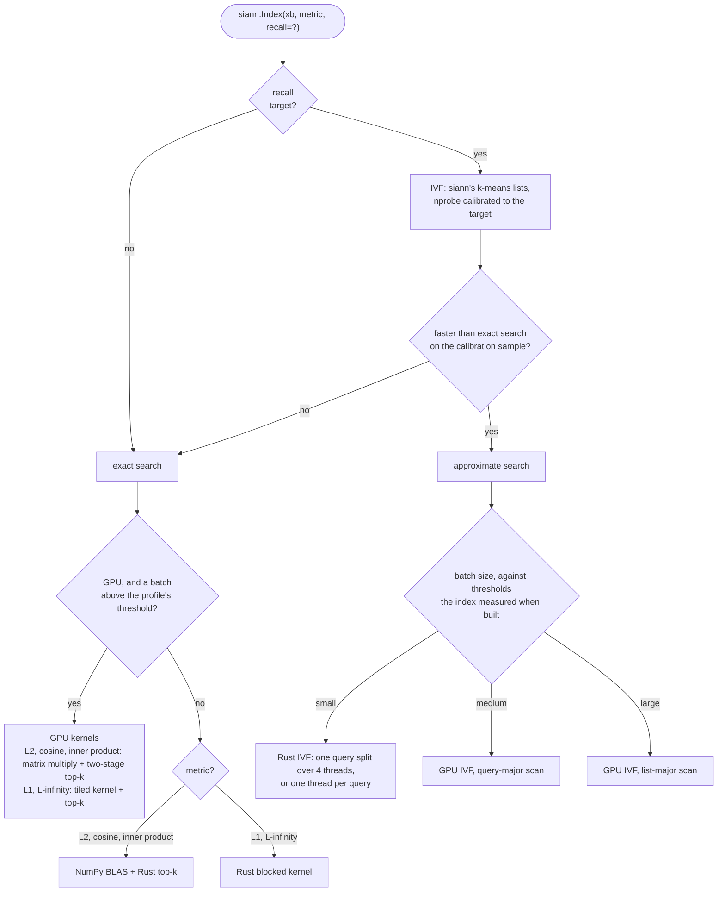
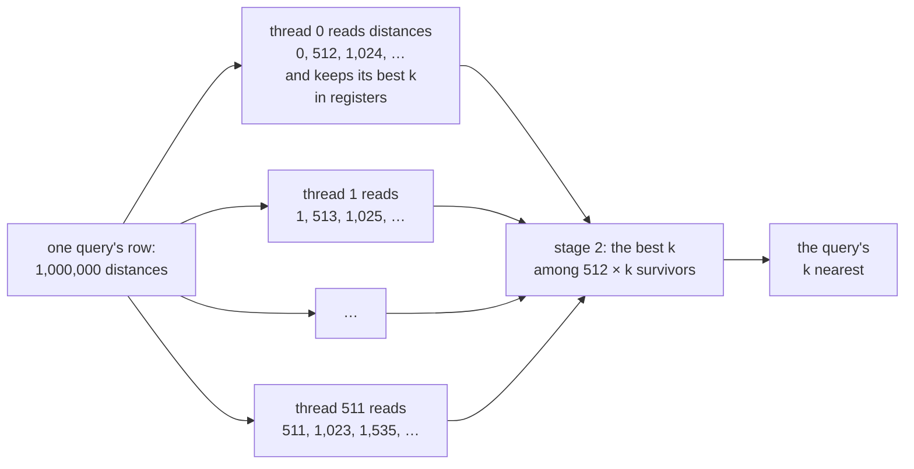
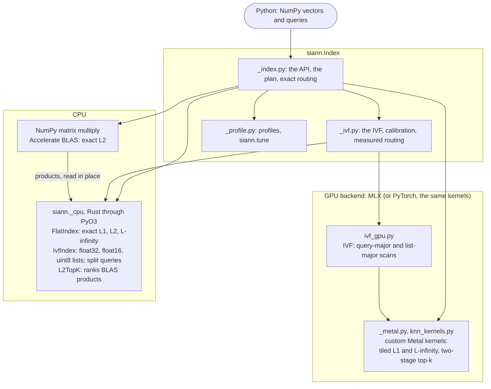

# Implementation

*Part of the [siann documentation](README.md#documentation).*

siann answers k-nearest-neighbor queries, exactly or to a recall target. It is fast for two reasons. It
**chooses**: it measures on your data and machine which method, settings and device meet the target
fastest for each batch size, reports what it chose, and chooses again as the index changes. And **each path
it chooses between is fast**, through custom GPU kernels and CPU code laid out for the hardware. This page
covers how siann chooses, the search methods and the kernels, where other libraries are faster and why, and
the code layout. The measurements are in [BENCHMARKS](BENCHMARKS.md), their summary in the README's
[How it compares](README.md#how-it-compares), and what to do when the defaults do not fit in
[TUNING](TUNING.md).

## Why siann is fast

### It chooses

How fast a search can be depends on the data, the metric, the machine, the batch size and the recall
wanted. siann takes the recall target and measures the rest:

| Choice | Made from |
| --- | --- |
| Exact search or an IVF | both timed on a sample of queries |
| How many lists a query scans (nprobe) | the fewest that reach the target on a sample of queries |
| CPU or GPU, and which scan, by batch size | for an IVF, each scan timed on 1 to 4,096 queries when the index is built; for exact search, a profile |
| How the lists are stored | the data: bytes where lossless, float16 for GPU batches |

The choices interact, which is why they are measured together rather than set from rules of thumb: where
the CPU and the GPU cross depends on how many lists a query scans, and that depends on the data and the
target ([TUNING](TUNING.md#approximate-search-where-each-batch-runs) has the crossovers measured).
[Approximate search through siann.Index](BENCHMARKS.md#approximate-search-through-siannindex) measures what
the choices gain.

Other libraries leave these choices to you: FAISS and mlxvs offer a family of indexes and their parameters,
and you pick the index, its settings and, for FAISS, the device. FAISS's auto-tuning (`ParameterSpace`)
explores one index's parameters on one device against ground truth you compute; it does not choose between
exact and approximate search, between scans, or between the CPU and the GPU.

### Each path is fast

The choice is worth making only if every option is fast. Written with a framework's built-in operations,
every GPU backend is slower than FAISS on the CPU ([BACKENDS](BACKENDS.md#summary)), so siann runs its own
code: custom Metal kernels on the GPU (Metal is Apple's GPU language), and on the CPU Rust kernels laid out
for the vector instructions and BLAS (the tuned linear-algebra library) for L2. [The kernels in
detail](#the-kernels-in-detail) explains where each gain comes from.

## How siann chooses

### Which path a search takes

### From a recall target to an index

`siann.Index(xb, metric, recall=0.95)` turns a recall target into an IVF and its settings, in about 5-9
seconds for a million vectors:

1. **The lists:** about 4 sqrt(n) of them (4,000 for a million vectors), from siann's k-means, stored as
   bytes where every coordinate is an integer from 0 to 255 (lossless), and otherwise as float16 on the GPU
   (recall moves by at most 0.001) and float32 on the CPU.
2. **Calibration:** a sample of 1,000 queries is searched exactly, then with the IVF at a doubling nprobe
   until it reaches the target recall@10, and a bisection narrows nprobe to the smallest that does. The
   sample is the index's own vectors (each one's own match left out) unless representative queries are
   given (`calibration_queries=`). Recall counts a neighbor as found when it is no farther than the true
   10th, so that ties broken differently are not misses.
3. **IVF or exact:** the IVF at the calibrated nprobe is timed against exact search on the same sample, and
   the index keeps whichever is faster.
4. **Routing:** the index times its CPU scans (one query split over 4 threads, one thread per query with
   its coarse step in Rust or through BLAS, and list-major) and its GPU scans (query-major and list-major)
   on 1 to 4,096 of the calibration queries, each path by itself after a warm-up pass on the GPU, and
   keeps a measured route where it beats the default by the timings' spread
   ([TUNING](TUNING.md#approximate-search-where-each-batch-runs)).

Exact search routes by a *profile*: for each metric, the batch size from which the GPU is faster; siann's
own, or one `siann.tune` measures on your data and machine ([TUNING](TUNING.md#exact-search-gpu-or-cpu)).
Every choice can be overridden (the README's [Python](README.md#python) section lists how).

### Threads

An index can be searched from several threads at once, and changed while it is searched. Each search
begins by taking a snapshot of the index, its vectors, lists, buffer and mask as they are at that moment,
and searches that: changes replace the arrays they change rather than writing into them, and take a lock,
so a snapshot never mixes two states. Searches do not hold the lock while they run, so concurrent searches
proceed in parallel: on the CPU, 4 threads answer 1.6-1.9 times as many queries as one (BENCHMARKS,
[Threads](BENCHMARKS.md#threads)). Changes run one at a time, and a search that began before a change
returns results from before it. Each device's copy of the vectors is built once, by the first search that
needs it.

### Memory

On Apple silicon the GPU's memory is the machine's, so a GPU search that outgrows it does not fail: the
system swaps or stalls. siann keeps each GPU call's working memory within a budget, 4 GB, or a quarter of
the GPU's recommended working set (what Metal says it can use without paging) on a machine where that is
smaller:

- **A large batch is searched in equal chunks.** The IVF's working memory grows with the batch: each
  query's distances to every centroid, and in the list-major scan 16 lanes of k candidates per probed list.
  The chunk is the budget over that, 25,600 queries on SIFT1M at nprobe 46. Exact search works on 256
  queries at a time, fewer once a tile's distances to every base vector would exceed the budget (from
  about 2.8 million vectors).
- **Splitting never changes results,** as each query's depends on it alone, so the budget may depend on
  the machine and the neighbors still do not.
- **MLX's cache of freed buffers is capped** at twice the budget (by default it may hold as much as the
  working set), unless the program has set a lower cap itself. PyTorch's allocator is left as it is: it
  held at most 2.5 GB after the same searches.
- **An index whose GPU copy would take more than half the working set stays on the CPU,** at the build, at
  a load, or at the merge that grows it past that; `device="gpu"` is then refused with the reason, and
  `index.plan` says so.

What the index holds grows with it, not with the batch: the vectors, each device's copy, and during a
merge, copies of the vectors as the lists are rebuilt (BENCHMARKS, [Memory](BENCHMARKS.md#memory)).

### Saving and loading

`index.save(path)` writes one NumPy `.npz` file, read back with pickling disabled: the base vectors (as
bytes where every coordinate is an integer from 0 to 255), the IVF's centroids and each vector's list,
the calibration sample, and a JSON header with the metric, the recall target, the calibrated nprobe, the
storage, the routes, the profile and the plan, with the machine the routes were measured on.
`siann.Index.load(path)` rebuilds each device's copy of the lists from them the first time a search needs
it, as when the index was built, so the file assumes no device. What the index decided from the data, its
lists and nprobe, and its choice between the IVF and exact search, are kept, so a loaded index returns the
same neighbors anywhere. What it decided from the machine, its routes and profile, is kept on the same
machine and re-measured on another (`remeasure=` forces either). A file of a later format is refused.

### Changing an index

`index.add(x, ids=)` adds vectors and `index.remove(ids)` removes them. Each vector has an id, which searches
return: its row number unless `ids=` names it. Rebuilding each device's copy of the index for every change
would cost under a second per million vectors, but each time, so changes are gathered first:

- **Added vectors join the lists of their nearest centroids,** which stay as they are. That keeps the IVF's
  recall: as a collection grows, even tenfold or into regions its centroids never saw, recall at the
  calibrated nprobe holds or rises. Until the buffer is merged, its vectors are searched exactly and the
  two sets of results merged by score.
- **nprobe is recalibrated at every merge,** on the calibration sample (a fresh sample of the index's own
  vectors, or the given queries), so that the target holds after changes: queries in new regions can fall
  below it otherwise.
- **The cost of inserting without re-clustering is speed, through unbalanced lists,** as new vectors crowd
  into the lists nearest them. So the IVF is re-clustered when its largest list against the mean has
  doubled since its last clustering, or the index has doubled in size (the number of lists grows with it).
  `index.recluster()` does it on request. Re-clustering runs in the `add()` that crosses the threshold.
- **Removed vectors are masked,** and each search fetches 8 more neighbors than asked and drops them; a
  query that lost more than 8 is searched again, fetching as many more as are masked, so results stay
  exact. The index is compacted, and nprobe recalibrated, once 512 are masked.
- **An index can start empty,** from an array of shape (0, d), and grow by `add()`. Until the first merge
  its vectors are in the buffer, searched exactly. With a recall target, the choice between an IVF and
  exact search waits for that merge, as there is nothing to measure before it, and is then made as at a
  build. An index that keeps exact search makes the choice again at a merge once it has doubled in size
  since the last one, so that it turns into an IVF as it grows past where exact search is faster, without
  building an IVF at every merge. Removing every vector returns an index to empty.
- **`index.calibrate(queries)`** gives the calibration queries after the build, for example once real
  queries exist: an IVF recalibrates nprobe and re-measures its routing on them at once, and every later
  merge and choice uses them.
- `index.save()` merges and compacts first, and the file keeps the ids, the options the index was built
  with and the calibration queries. `index.plan` says what changed, when the index last merged and
  re-clustered, and why.

The measurements behind these choices are in BENCHMARKS, [Changing an index](BENCHMARKS.md#changing-an-index).

## Distances

- **L2** (Euclidean): the square root of the sum of squared differences. Searches compare squared
  distances, which rank the same way and need no square root.
- **L1** (Manhattan): the sum of absolute differences. It is less sensitive to a few large
  differences than L2, and has no matrix-multiply form (see below), which makes it the harder case
  and the one where siann gains most.
- **L-infinity** (Chebyshev): the largest absolute difference in any one coordinate. It shares L1's
  kernels, with a running maximum where L1 keeps a running sum. A maximum involves no rounding, so
  its distances are exact.
- **Inner product:** q·x, largest first, for embedding models trained to be compared by it. siann
  ranks by -q·x, so that smaller is nearer, as for the distances. Exact search is a matrix multiply,
  like L2 without the norms.
- **Cosine:** the angle between vectors. Normalized to unit length, vectors rank by cosine exactly as
  they rank by L2, so cosine search is L2 search on normalized vectors (see [DATASETS](DATASETS.md)).

## The search methods

### Exact search

Exact search computes a distance for every pair of query and base vector, then keeps each query's k
smallest.

**L2 as a matrix multiply.** The squared distance expands to `|q - x|² = |q|² - 2 q·x + |x|²`. The term
`|q|²` is the same for every base vector of a query, so it does not change the ranking and is dropped.
What remains, for a tile of queries Q against all base vectors X, is `|x|² - 2 Q Xᵀ`: one matrix
multiply, which GPUs and the CPU's BLAS do at close to their peak speed, plus the base vectors' squared
norms, computed once. Inner product is the same multiply without the norms.

**L1 and L-infinity** have no such expansion, so every distance is computed coordinate by coordinate,
by kernels laid out like a matrix multiply so that each base vector is read from memory once for many
queries.

**Top-k selection.** With the distances computed, each query needs its k smallest of a million, which is
as costly as the distances unless it is done carefully (see the kernels below).

### IVF: approximate search

An IVF (inverted file) index clusters the base vectors and searches only the clusters nearest the
query. It trades a little recall (the share of the true k nearest neighbors found) for a large cut in
work.

**Building.** k-means (siann's own, on the GPU where there is one: 10 iterations of Lloyd's algorithm on a
sample of 100 vectors per cluster, from randomly chosen starting vectors) finds the cluster centers, the
centroids. Each base vector then goes to the list of its nearest centroid in the search metric, found by
exact search, except for inner product, whose lists are assigned by L2 (by inner product, centroids
pointing towards long vectors attract much of the data and the lists fall badly out of balance). k-means
itself runs in L2, even for an L1 index: the centroids only need to spread over the data. Queries always
probe by the search metric. Where the probed lists hold fewer than k vectors, the missing neighbors are
returned as -1. The GPU and CPU IVFs take their lists from the same build, so they hold the same lists.

**Searching.** A query's `nprobe` nearest centroids (the coarse step) give the lists to scan; the k
nearest vectors among those lists are the answer. Raising `nprobe` raises recall and cost: on SIFT1M
with L2, nprobe 16 finds 84% of the true neighbors, nprobe 64 97%, nprobe 128 99%.

**Query-major and list-major scans.** There are two ways to scan:

- **Query-major:** each query walks its own lists. Cheap for a single query, but in a batch every query
  reads its lists separately, so a popular list is read from memory many times. FAISS's IVF scans this
  way.
- **List-major:** queries are first grouped by the lists they probe, and each list is scanned once for
  all of them, then each query's results from its lists are merged. In a batch of 10,000 queries at
  nprobe 64, each list is probed by about 160 of them, and read once instead of 160 times.
- **Split single queries:** a single query's coarse step and lists divided among a few threads (a pool of
  their own, 4 by default), each keeping its own best k, merged into the one-thread result, ties included. This cuts a single query's latency, 1.3-2.0 times, at the cost of
  occupying the threads.

Which scan pays depends on the batch and on nprobe, which is why each index measures its routing. Every
scan returns the same neighbors: among vectors at exactly the same distance, the one with the smaller id
comes first, whatever order the lists were scanned in (ties are common on integer data such as SIFT's).

**The coarse step.** Finding the nearest nprobe centroids is itself a small exact search (4,000
centroids), and for a single query on one thread it is about half the work at nprobe 16. Splitting a
single query over 4 threads spreads the coarse step with the lists, so a cheaper coarse step buys
little there ([What does not pay](DEVELOPMENT.md#what-does-not-pay)).

For a batch on the CPU, by L2, cosine or inner product, the coarse step can instead be one BLAS matrix
multiply of the queries against the centroids, whose products Rust ranks as it ranks its own distances,
finding the same lists. The list-major scan always does it this way (1.06-2.0 times faster from 10 queries). For the
query-major scan it depends on the machine: with 4 threads it pays from about 32 queries (up to 1.6 times
faster), with 16 it does not, as each query's own coarse step is already spread over 16 cores. So it is a
route each index measures (BENCHMARKS, [The coarse step](BENCHMARKS.md#the-coarse-step)).

**List storage.** The scan reads every vector of every probed list, so in a batch of queries scanned one
by one it is limited by memory traffic, not arithmetic. The lists can therefore be stored in a smaller
type, with distances still computed in float32 from the stored values:

- **float16** (half the bytes): each coordinate rounded to half precision. On SIFT, whose coordinates are
  small integers, this is exact; on GloVe it changes each coordinate by at most 2.4e-4, and recall by at
  most 0.001.
- **uint8** (a quarter): one byte per coordinate, for data whose coordinates are integers from 0 to 255,
  like SIFT's, so nothing is lost. Other data is refused: scaling it into bytes (int8 quantization) would
  lose precision and need re-ranking.

Smaller lists make the query-major scan 1.3-3.0 times as fast in batches of 100, with recall unchanged.
They cost where the scan is not memory-bound: a single query on one thread reads its lists below the
memory system's limit, so widening float16 is pure extra work, while the list-major scans already read
each list once for many queries.

## The kernels in detail

### On the GPU

siann's GPU kernels are Metal source, written once (`siann._metal`) and compiled by either GPU backend: MLX
(`mx.fast.metal_kernel`, the faster on Apple silicon) or PyTorch's MPS backend (`torch.mps.compile_shader`),
chosen by `siann.Index(..., gpu="mlx" | "torch")`.

The two-stage top-k, for one query's row of distances to a million base vectors:

Every thread reads the row once, in a pattern where neighboring threads read neighboring memory, and keeps
only k values, so nothing but the survivors is written back; a full selection over the row would sort or
partition all of it.

- **A two-stage top-k, the largest single gain.** The frameworks' own selection (`argpartition`, `topk`)
  takes 146-152 ms per tile of 256 queries against a million vectors, eight times the distances. siann
  selects in two stages: 512 threads per query each scan a strided share of the row, keeping their best k
  in registers by insertion, then a small selection over the 512 × k survivors gives the final k: 4.1 ms,
  35 times faster.
- **L1 and L-infinity as a tiled kernel.** Each group of 16 × 16 threads computes a 64 × 64 block of
  distances, 4 × 4 per thread, held in registers. The group loads 16 dimensions of its 64 queries and 64
  base vectors at a time into threadgroup memory (a small, fast memory shared by the threads of a group),
  so each base vector is read from main memory once per 64 queries rather than once per query. The step
  that folds a coordinate difference into the running distance is a sum for L1 and a maximum for
  L-infinity, at the same speed, where FAISS's L-infinity takes three times its own L1 time.
- **L2 as one fused multiply** (`addmm`, which adds a matrix to a scaled product): 6.9 against 17.7 ms per
  tile with the multiply, scaling and subtraction as separate steps.
- **Each tile evaluated before the next.** Queries go 256 at a time, so that only one tile's distances
  (256 × 1M, 1 GB) are held at once. MLX evaluates lazily (it builds a graph of operations and runs it
  when a result is needed), so a search evaluated only at the end keeps every tile's distance matrix
  alive: 196 s instead of 0.9 s for 10,000 queries.
- **The IVF's query-major scan:** 128 threads per query each take a strided share of its lists and keep
  their best k in registers, then merge them pairwise in threadgroup memory (seven steps), so the kernel
  writes only k results per query. Choosing each query's nprobe lists in order costs as much as the scan
  (at nprobe 64 a running top-64 does not fit in registers), and the scan needs them in no order, so the
  GPU backend's own partial selection (MLX's `argpartition`, PyTorch's `topk`) chooses them, at a third of
  the cost.
- **The IVF's list-major scan:** one group of 256 threads per list handles 16 queries at a time, with the
  list's vectors staged through threadgroup memory; the queries are grouped on the GPU too (a sort of the
  probe lists and a count per list). Above nprobe 16 its probe selection is unordered as well; at 16 and
  below the two-stage selection with 32 threads per query is cheaper for thousands of queries.
- **Smaller lists read directly:** the kernels read float16 and uint8 lists without converting them first.

### On the CPU

On the CPU siann runs a small Rust extension, exposed to Python through PyO3 (the bridge that lets Python
call Rust), plus NumPy's matrix multiply, which on a Mac is Apple's Accelerate BLAS (it runs matrix
multiplies on the chip's matrix units).

- **L2 through BLAS, in cache-sized tiles.** NumPy's `@` computes the products of a tile of queries with a
  block of the base, and a Rust top-k ranks them by |x|² - 2 q·x, reading NumPy's arrays in place (through
  rust-numpy, without copying) and keeping each query's best k across blocks. Products of 4-8 million
  values (16-32 MB) are fast; smaller ones pay per-call overhead and larger ones fall out of cache. The
  default takes up to 512 queries and about 4 million values per product. FAISS's exact L2 is the same
  Accelerate multiply, and its own blocks (4,096 queries by 1,024 vectors) fall in the same window, so
  siann's lead over it is not simply its block size.
- **L1 and L-infinity: a blocked layout.** FAISS's flat L1 runs at about 70 G absolute differences per
  second, well below what the cores can do. siann stores the base vectors once, at build time, in blocks
  of 8, dimension by dimension: the first dimension of 8 vectors, then their second, and so on. The inner
  loop compares 4 queries with one block, keeping 32 running sums, one per pair. The sums do not depend
  on each other, so the compiler turns the loop into NEON instructions (Apple's vector instructions, 4
  numbers at a time), 8 absolute differences and 8 additions per dimension, without reordering any
  floating-point additions. (Floating-point addition is not associative, so a compiler may not vectorize
  a single running sum by splitting it; 32 separate sums sidestep the issue.) About 270 G per second.
- **Cache tiles and threads.** Each thread takes 32 queries and scans the base in tiles of 1,024 vectors
  (512 KB), comparing each tile with all of its queries while the tile is in cache. A batch too small to
  occupy every thread this way (below 512 queries on 16 threads) also divides the base among threads, by
  ranges of tiles, and merges each query's best k from the ranges in order of distance, then index, the
  order one thread keeps, so the neighbors are the same: 1.6-10.5 times faster on small batches. Each query keeps its
  best k in a small sorted list. The last block is padded with vectors of infinity, whose distances never
  enter a top-k (for inner product, where infinity would be the best score, padding slots are skipped by
  index). The same kernel computes L2 by squaring the differences and L-infinity with a running maximum,
  written as a comparison and select.
- **The IVF on the CPU:** the query-major scan runs one thread per query; the list-major scan runs each
  list with the exact kernel, 4 queries at a time, while it is in cache. A split single query uses a thread pool of its own: a shared pool costs about 100
  microseconds per query to wake its threads, as FAISS's own split (`parallel_mode = 1`) does.
- **Integer arithmetic for byte lists.** A query whose coordinates are all integers from 0 to 255 is
  compared with byte lists in exact integer arithmetic, over a row-major copy of the lists (each vector's
  bytes contiguous, so that 16 of them fill a register and L2's sum is one dot-product instruction per 16
  values): 1.8 times the float path on one thread, level with FAISS's IVF. Other queries convert the bytes
  to float32 in registers inside the distance loop, so nothing is rounded; with the copy, byte lists take
  two bytes per coordinate, half of float32's.
- **float16 lists.** Rust has no stable float16 type, so float16 lists hold the half-precision bits as
  16-bit integers, and each block is widened to float32 in one flat loop before the distance code runs on
  it. The widening is exact: sign, exponent and mantissa move into float32's positions, read as a number
  2^112 times too small, normal or subnormal, which one multiply corrects; `check_kernels.py` compares it
  with NumPy's conversion on every finite float16.

## Where other libraries are faster, and why

The baseline is always the strongest option for the case: FAISS's on the CPU, its compressed indexes
included, and mlxvs's on the GPU. How much each leads by is in the README's
[How it compares](README.md#how-it-compares); the reasons are these.

- **FAISS's HNSW for single queries and small batches on SIFT-like data.** HNSW, a graph index, touches 7-9
  times fewer vectors per query than an IVF on SIFT ([Work per query](BENCHMARKS.md#work-per-query)), and
  compressing its vectors speeds it up as much as it speeds up the IVF. On GloVe-like data a graph must
  walk much further for the same recall and its scattered reads cancel the difference, while an IVF's dense
  scans do not care, so siann leads there at every batch size; with 4 threads per query it leads on SIFT
  too, from recall 0.97.
- **FAISS's HNSW on vectors of very uneven length.** On raw GloVe (lengths 0.04 to 18.7) no IVF reaches high
  recall, and FAISS's HNSW with inner product is the approximate method; siann's exact search on the GPU,
  4-18 times FAISS's exact search, is the choice where recall must be 1.0
  ([Inner product](BENCHMARKS.md#inner-product)).
- **mlxvs's CAGRA in GPU batches on SIFT-like data and inner product.** CAGRA, from NVIDIA's cuVS, is a graph
  index built for the GPU, and like HNSW touches far fewer vectors per query than an IVF. On GloVe-like data
  the two are level, and CAGRA reaches recall 0.882 at most in the settings measured. mlxvs has no L1 or
  L-infinity, and on single queries siann's CPU path is 2.7-5.2 times faster than mlxvs's GPU
  ([Against mlxvs](BENCHMARKS.md#against-mlxvs-on-the-gpu)).
- **High-dimensional embeddings.** At 1,536 dimensions the matrix multiply, the same in every library,
  dominates exact search, so siann's lead shrinks, and CAGRA's fewer vectors per query count for more
  ([High-dimensional text embeddings](BENCHMARKS.md#high-dimensional-text-embeddings)).

## Code layout

| File | What it holds |
| --- | --- |
| `python/siann/_index.py` | `siann.Index`: building, searching, the plan, exact routing |
| `python/siann/_ivf.py` | The IVF behind `Index(recall=)`: calibration, the timed choice against exact search, measured routing |
| `python/siann/_profile.py` | `siann.Profile`, `siann.tune`, the default profile |
| `python/siann/_memory.py` | The GPU memory budget, MLX's cache cap and whether an index fits on the GPU |
| `python/siann/_build.py` | Checks run before the Rust extension loads: the processor's features, OpenBLAS's threads |
| `python/siann/kmeans.py`, `ivf_build.py` | siann's k-means and the IVF's lists, built once for every backend |
| `python/siann/_metal.py` | The Metal kernels' text, shared by both GPU backends: the two-stage top-k, the tiled L1 and L-infinity kernel, the IVF scans |
| `python/siann/knn_kernels.py`, `exact.py` | Exact search on MLX: the kernels compiled from `_metal`, fused L2, the top-k, a tile of queries at a time |
| `python/siann/ivf_gpu.py` | The GPU IVF: query-major and list-major scans, float16 and uint8 lists |
| `python/siann/blas_l2.py` | Exact L2 and inner product on the CPU through NumPy's BLAS and `L2TopK`, with the default tile sizes |
| `python/siann/torch_kernels.py`, `ivf_torch.py` | The same kernels on PyTorch MPS |
| `crates/siann/` | The engine, a Rust crate with no Python types: the metrics (`metric.rs`), list storage (`elem.rs`), the blocked layout, distance loops and top-k (`kernels.rs`), exact search (`flat.rs`), the IVF (`ivf.rs`), ranking BLAS products (`products.rs`), and scoring, ranking, merging and bookkeeping (`ops.rs`); tested by `cargo test` (`tests.rs`) |
| `crates/siann-py/` | The Python bindings, `siann._cpu`: `FlatIndex`, `IvfIndex`, `L2TopK` and the functions, over the engine |
| `benchmarks/check_kernels.py` | Every kernel and index against NumPy's exact search |
| `benchmarks/` | The benchmarks against FAISS and mlxvs, their raw output in `results/` |

There is no Rust core between Python and the GPU: a GPU backend goes from Python to Metal directly. The
Python package lives in `python/siann/`, and maturin (the tool that builds Rust extensions for Python)
compiles the Rust crate into it as `siann._cpu`; `pyproject.toml` at the top of the repository ties the
two together. FAISS appears only in the benchmarks: siann does not call it. [DEVELOPMENT](DEVELOPMENT.md)
covers building, testing and the rules for changing the code.
