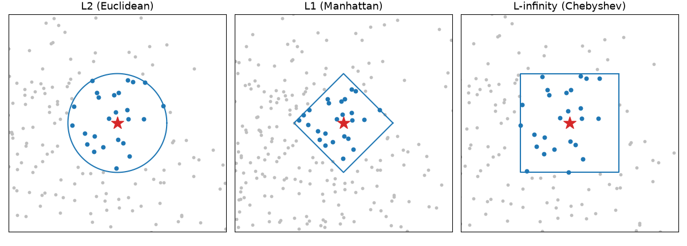

# siann

[](https://github.com/vglazer/siann/actions/workflows/ci.yml)
[](https://pypi.org/project/siann/)
[](https://siann.readthedocs.io)

**Nearest-neighbor search that decides how to search, on Apple silicon.** Tell siann what you need, exact
neighbors or a recall target, for dense NumPy vectors by Euclidean (L2), cosine, inner product, Manhattan
(L1) or Chebyshev (L-infinity) distance. It chooses the method (exact search, or an IVF calibrated to the
target) and the device for each batch size (the CPU or the Apple GPU) from measurements on your data and
machine, says why in `index.plan`, and keeps choosing as the index grows and changes.

Each path it chooses between is fast in its own right, through custom GPU kernels and CPU code laid out for
the hardware ([IMPLEMENTATION](IMPLEMENTATION.md)); where another library is faster,
[How it compares](#how-it-compares) says so. Start with the
[quickstart notebook](https://github.com/vglazer/siann/blob/main/examples/quickstart.ipynb).



*One query's 25 nearest points by Euclidean (L2), Manhattan (L1) and Chebyshev (L-infinity) distance.*

## Install

```sh
uv add siann            # or: pip install siann
```

siann runs on Python 3.12 or later: on the CPU on Linux, macOS and Windows, and on the GPU too on Macs with
Apple silicon, where it installs MLX for it. Wheels (built packages) cover Linux on x86-64 and ARM, macOS on
Apple silicon and Windows on x86-64. The x86-64 wheels need a processor with AVX2 (Intel from 2013, AMD
from 2015); on an older one, `pip install --no-binary siann siann` builds from source, which takes a
[Rust](https://rustup.rs) toolchain. On Linux and Windows, import siann before NumPy
([TUNING](TUNING.md#numpys-blas-on-linux-and-windows)).

## Python

```python
import numpy as np
import siann

xb = np.random.default_rng(0).standard_normal((100_000, 128), dtype=np.float32)
xq = np.random.default_rng(1).standard_normal((1_000, 128), dtype=np.float32)

index = siann.Index(xb, metric="cosine")     # exact; or "l2", "l1", "linf", "ip"
res = index.search(xq, k=10)                 # res.indices, res.scores: (1000, 10) each, best first
print(index.plan)                            # what siann chose, and why

approx = siann.Index(xb, metric="cosine", recall=0.95, calibration_queries=xq)  # an IVF, if faster
ids = approx.add(xq)                         # add vectors; searches return their ids
approx.remove(ids[:10])                      # remove them by id
approx.save("approx.siann")                  # siann.Index.load("approx.siann"), on any machine

grown = siann.Index(np.empty((0, 128), np.float32), metric="l2", recall=0.95)  # start empty, grow by add()
```

Scores are each metric's natural value: the distance for L2 (not squared), L1 and L-infinity, the
similarity for cosine and inner product. Every choice can be overridden: `device=`, `kind="exact"` or
`"ivf"`, `nlist=`, `storage=`, `nprobe=` for one search, `gpu="torch"` for PyTorch's MPS backend instead of
MLX, and a profile from `siann.tune` for the routing ([TUNING](TUNING.md)).

## What siann does for you

**It takes a target, not settings.** With `recall=0.95`, siann builds an IVF, finds how many lists each
query must probe to reach the target, and keeps it only if it beats exact search. Calibrating on a sample of
your queries (`calibration_queries=`, or later `index.calibrate()`) makes the target hold on them
([TUNING](TUNING.md#calibration-meeting-the-recall-target-on-your-queries)).

**One index uses both the CPU and the Apple GPU,** each search sent where its batch size runs fastest on
your data and machine: typically single queries to the CPU, batches to the GPU
([TUNING](TUNING.md#approximate-search-where-each-batch-runs)).

**Every common metric is fast,** L1 and L-infinity included, with kernels of their own on the GPU and in
Rust on the CPU ([IMPLEMENTATION](IMPLEMENTATION.md#distances)).

**The index keeps choosing as it changes.** It can start empty, grow and shrink, keep ids of your own, and
be searched from several threads while it changes; siann merges, recalibrates, re-clusters, and switches
from exact search to an IVF once that is faster ([IMPLEMENTATION](IMPLEMENTATION.md#changing-an-index)).

**It explains itself.** `index.plan` lists each choice and the measurement behind it: method, nprobe and
the recall reached, storage, routes, memory, what changed since the build.

**It is safe on unified memory.** GPU searches stay within a memory budget, so a large batch cannot stall
the Mac, and an index too large for the GPU stays on the CPU ([IMPLEMENTATION](IMPLEMENTATION.md#memory)).

## How it compares

Measured on an Apple M3 Max: queries per second of siann's routed path divided by the other's, above 1 where
siann is faster, with exact search returning the same neighbors and approximate search compared at matched
recall. Against FAISS 1.16 (its faster path, CPU or Metal GPU), and on the GPU against mlxvs 0.16.1 (NVIDIA
cuVS's methods on MLX, CAGRA graphs included). SIFT1M (image descriptors, L2),
GloVe-100 (word embeddings, cosine), Music-100 (inner product) and DBpedia OpenAI embeddings (1,536
dimensions) favor different methods ([DATASETS](DATASETS.md)).

| Workload | Against FAISS | Against mlxvs |
| --- | --- | --- |
| Exact, L1 or L-infinity | L1 **18.5-25x**, L-infinity **47-49x** (its CPU; neither GPU library has these metrics) | |
| Exact, L2, cosine or inner product, batches of 100 | **2.7-2.9x** (its GPU) | **2.6-3.8x** in batches; 1.1-1.2x at 1,536 dimensions |
| Exact, batches of 10,000 | L2 and cosine **5.6-6.0x** (its GPU), inner product **3.5x** (its CPU) | |
| Approximate, single queries (HNSW on the CPU) | split over 4 threads, as siann answers them: GloVe **1.5-3.1x**, SIFT 0.45x at recall 0.83 and **1.2-1.6x** from 0.97; on one thread (many concurrent queries): GloVe **1.6x**, Music-100 0.85-1.4x, SIFT 0.64-0.73x | |
| Approximate, batches of 100 | GloVe **1.2-1.8x**, Music-100 0.77-1.05x, SIFT 0.67-0.84x below recall 0.99 (HNSW) | CAGRA: GloVe and Music-100 level, SIFT 0.67-0.83x |
| Approximate, batches of 10,000 | GloVe **5.0x**, Music-100 **2.1-2.3x**, SIFT **1.2-1.3x** (HNSW) | CAGRA: GloVe level, Music-100 0.67-0.69x, SIFT 0.38-0.48x |
| Approximate, 1,536 dimensions (100,000 vectors) | single queries 0.37-0.42x (HNSW) | CAGRA: 0.35-0.53x |

FAISS's GPU IVF is no faster than its HNSW at matched recall in any case measured, so HNSW is FAISS's
approximate method on the Mac. Without a GPU, siann's CPU path against FAISS's: exact L1 3.8-4.3x and
L-infinity 7.3x, L2 and cosine 1.7-1.9x on 1,000 queries and 3.0-3.6x on 100, inner product 0.9-2.7x.
[BENCHMARKS](BENCHMARKS.md) has the measurements behind each row and how to rerun them.

## Documentation

| Document | What it covers |
| --- | --- |
| [Quickstart notebook](https://github.com/vglazer/siann/blob/main/examples/quickstart.ipynb) | Every feature, hands-on |
| [IMPLEMENTATION](IMPLEMENTATION.md) | How siann chooses, the search methods, the kernels, where other libraries are faster |
| [TUNING](TUNING.md) | What siann measures, on what, and how to measure it on your own queries, data and hardware |
| [BENCHMARKS](BENCHMARKS.md) | Every measurement, with the scripts that reproduce them |
| [BACKENDS](BACKENDS.md) | MLX, PyTorch MPS, FAISS and siann's Rust code: what each offers, and their pitfalls |
| [DATASETS](DATASETS.md) | SIFT1M, GloVe-100, Music-100, DBpedia OpenAI and Gaussian vectors |
| [DEVELOPMENT](DEVELOPMENT.md) | Building, testing, releasing, the rules for changing the code, and the ideas that do not pay |
| [API reference](https://siann.readthedocs.io/en/latest/API/) | Every public class, method and function |

These pages are also at [siann.readthedocs.io](https://siann.readthedocs.io).

## License

MIT ([LICENSE](https://github.com/vglazer/siann/blob/main/LICENSE))
